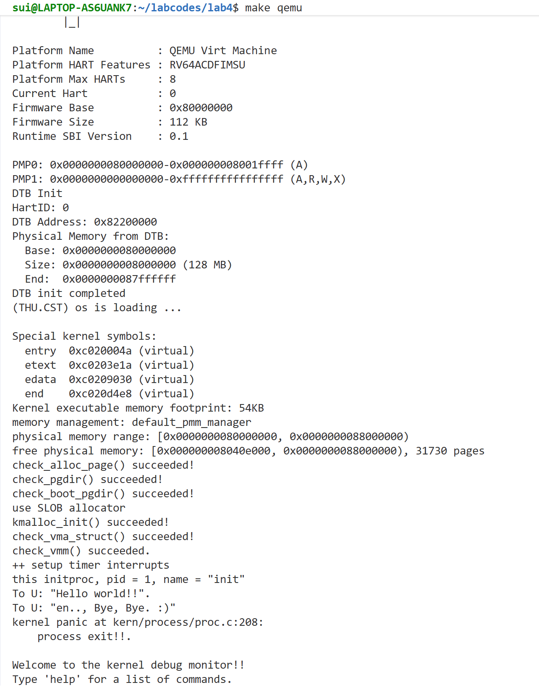
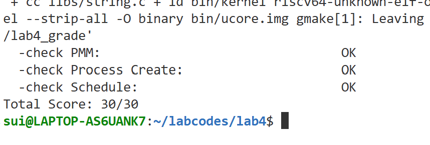

# 操作系统实验报告

## 实验基本信息

| 项目 | 内容 |
| --- | --- |
| 实验名称 | Lab4：进程管理，Sv39 页映射与内核线程调度 |
| 小组成员 | 2411564－刘欣怡、2411846－鞠昀慧、2411690－白诗雨 |
| **完成日期** | 2026-11-17 |

### 小组分工

以下安排按 Lab4 三个功能模块拟定，提交前由组员核对实际贡献。WSL 编译、启动和评分复测已有终端记录。

| 成员 | 实验与代码工作 |
| --- | --- |
| 刘欣怡 | 功能一。检查页映射建立、同页权限更新、异页替换、引用计数和失败回滚。 |
| 鞠昀慧 | 功能二。核对 `idleproc`、`initproc` 的创建，检查 PCB、内核栈、trapframe 初始化和首次运行路径。 |
| 白诗雨 | 功能三。核对调度与上下文切换的流程，完成 WSL 普通启动、课程评分复测并整理日志。 |

| 成员 | 负责的报告部分 |
| --- | --- |
| 刘欣怡 | 页操作的 SPEC 与 Prompt、Sv39 页表相关思考题。 |
| 鞠昀慧 | 线程创建的 SPEC 与 Prompt、首次运行流程。 |
| 白诗雨 | 调度的 SPEC 与 Prompt、本地中断控制、调试记录与评分结果。 |
| 三人共同 | 对照实验要求核对代码、报告与实验结果。 |

## 一、实验目的

1. 理解 Sv39 多级页表的查找过程，掌握建立和撤销页映射时对 PTE、物理页引用计数和 TLB 的维护。
2. 理解 VMA 的地址区间描述，以及它与硬件页表映射的关系。
3. 掌握 PCB、PID、内核栈及 trapframe 的初始化过程，能够解释 `idleproc` 与 `initproc` 的创建方式。
4. 理解单核协作式调度，跟踪内核线程第一次运行与已有线程恢复执行的两条路径。
5. 用普通启动日志和课程评分验证内存管理、进程创建及调度。

## 二、实验环境与 AI 工具

### 2.1 运行环境

| 项目 | 配置 |
| --- | --- |
| 开发环境 | Windows 上的 WSL Ubuntu |
| 模拟平台 | QEMU `virt`，RV64，设备树显示 128 MiB RAM |
| 课程模拟器 | QEMU 4.1.1，运行日志显示 OpenSBI v0.4 |
| 交叉编译工具 | `riscv64-unknown-elf-` 工具链 |
| 内核与分页 | S 模式，Sv39 |
| 构建与验证 | GNU Make，普通启动与教师的 `make grade` |

### 2.2 AI 工具与模型

| 成员 | AI编程工具 | 底层模型记录 |
| --- | --- | --- |
| 刘欣怡 | Claude Code | GPT-6 |
| 鞠昀慧 | ChatGPT | GPT-6.1 |
| 白诗雨 | ChatGPT | GPT-6.1 |

## 三、实验整体逻辑分析

### 3.1 本章节的逻辑主线

本实验从内核启动时的一条执行流出发，逐步实现页映射维护、内核线程创建与单核协作式调度。页映射模块提供建立和撤销地址映射的操作，页分配接口为新线程提供内核栈，进程管理模块为每个线程准备运行现场。线程进入可运行状态后，调度器才能选择它并交给 CPU 执行。

在虚拟内存管理中，VMA 用左闭右开区间描述一段虚拟地址及其访问属性。Sv39 页表中的页表项保存虚拟页到物理页的映射及访问权限，硬件按页表进行地址翻译。启动阶段会对 VMA 的插入和查找进行自检。本实验创建的内核线程共用内核页表，PCB 中的 `mm` 为 `NULL`。每个线程仍有自己的内核栈，用来保存函数调用和线程运行所需的现场。

启动时，`idleproc` 接管内核已有的执行现场，`initproc` 则通过线程创建流程获得自己的 PCB、内核栈和初始寄存器现场。当 `idleproc` 发起第一次调度时，CPU 根据为 `initproc` 预先设置的现场进入 `init_main()`。后续线程再次获得 CPU 时，可以从上一次切出的地方继续执行。

### 3.2 功能的逐步实现

1. **维护 Sv39 页映射。** 使用 `get_pte()` 定位 4 KiB 页对应的叶页表项。`page_insert()` 负责建立映射或更新权限。旧映射指向同一物理页时，引用计数保持原值。换成另一物理页时，分别调整新旧页的引用计数。`page_remove()` 清除有效映射，更新引用计数，并在修改页表后失效对应的 TLB 翻译。插入时如果中间页表分配失败，则回滚本次已分配的中间页表。
2. **创建内核线程并准备首次运行现场。** `proc_init()` 初始化进程链表，把启动执行流登记为 `idleproc`，再通过 `kernel_thread()` 创建 `initproc`。`do_fork()` 为新线程分配 PCB 和内核栈。`copy_thread()` 在栈上准备陷阱帧（`trapframe`），并把初始 `context.ra` 指向 `forkret`。现场准备完成后，新线程才被登记并置为可运行。
3. **选择线程并切换上下文。** `cpu_idle()` 检查到 `need_resched` 后调用 `schedule()`，从进程链表中选择可运行线程。`proc_run()` 更新 `current`，设置页表根并刷新 TLB。`switch_to()` 保存旧线程的寄存器并恢复新线程的寄存器。第一次切入 `initproc` 时，恢复出的返回地址让执行流进入 `forkret`，随后通过 `sret` 转入 `kernel_thread_entry`，最终调用 `init_main()`。

### 3.3 实现顺序与实际执行顺序

```text
kern_init
  ├─ pmm_init → 物理页分配、页表测试、SLOB 初始化
  ├─ pic_init / idt_init → 建立陷阱入口
  ├─ vmm_init → 验证 VMA 的插入和查找
  ├─ proc_init → 登记 idleproc，创建并登记 initproc
  └─ clock_init / intr_enable → cpu_idle → schedule → proc_run → switch_to
     → forkret → forkrets → __trapret → sret → kernel_thread_entry → init_main
```

实现顺序按三个模块逐步推进。实际启动时，内核先初始化内存与陷阱处理，再创建线程。时钟初始化并开启中断后，`idleproc` 才在 `cpu_idle()` 中发起第一次调度。

## 四、实验内容与实现

### 功能模块：虚拟内存页操作

**负责人**  2411564－刘欣怡

#### 模块功能描述

**涉及文件**  `kern/mm/pmm.c`

**需要实现的函数**

```c
int page_insert(pde_t *pgdir, struct Page *page, uintptr_t la, uint32_t perm);
void page_remove(pde_t *pgdir, uintptr_t la);
```

**功能说明与 SPEC**

输入是根页表的内核虚拟地址、物理页描述符、线性地址和权限。`page_insert` 成功返回 0，建立一个 4 KiB 叶映射；中间页表分配失败返回 `-E_NO_MEM` 并回滚本次已分配的中间页。同一地址重新映射到同一页只更新权限；替换成另一页时，旧页引用数减一、新页引用数加一。`page_remove` 只查现有页表，未映射时直接返回。撤销有效映射时依次清除 PTE、失效对应 TLB 翻译，并在引用减至 0 时归还物理页。

#### 最终提示词

````text
[PROMPT]
实现 uCore RISC-V Lab4 的虚拟内存页操作。只填写 kern/mm/pmm.c 中 LAB4 function1 标记所在区域，保留标记、现有 get_pte() 和测试。使用现有页表遍历和页分配接口，维护叶 PTE、物理页引用计数和本地 TLB。

[RELY]
类型和宏：pde_t、pte_t、struct Page、PDX1、PTE_V、PTE_R、PTE_W、PTE_X、PTE_U、E_NO_MEM。
已有函数：get_pte()、pte_create()、pte2page()、pde2page()、page2ppn()、page_ref_inc()、page_ref_dec()、free_page()、tlb_invalidate()。
RISC-V 指令：sfence.vma；普通叶映射更新使用模板提供的地址级 TLB 失效接口。

[GUARANTEE]
- 实现 int page_insert(pde_t *pgdir, struct Page *page, uintptr_t la, uint32_t perm)。
- 实现 void page_remove(pde_t *pgdir, uintptr_t la)。
- 实现内部辅助函数 static void page_remove_pte(pde_t *pgdir, uintptr_t la, pte_t *ptep)。

[SPECIFICATION]
- page_insert()：调用 get_pte(pgdir, la, 1) 获取 4 KiB 叶槽。旧槽无映射时将新页引用数加一；旧映射是同一物理页时只更新权限；旧映射是另一物理页时为新页增加引用，并撤销旧页映射。用 pte_create() 重建叶项，perm 未提供 R/W/X 或只给 W 等会导致 W=1、R=0 时补 R，合法的 X-only 保持原权限。刷新该地址的 TLB 后返回 0。获取叶槽失败时返回 -E_NO_MEM；如果本次已新建根项指向的中间表，则恢复根项、执行全局 sfence.vma，再释放该表页。失败时目标数据页引用数保持原值。
- page_remove()：调用 get_pte(pgdir, la, 0) 只查现有叶槽。没有叶槽或叶项无效时直接返回。有效映射交给 page_remove_pte() 撤销。重复删除同一地址不再扣减引用数。
- page_remove_pte()：对有效叶项先取得旧物理页，再清零 PTE、失效对应地址的 TLB 翻译、将旧页引用数减一。引用数减至 0 时释放该页；无效叶项不做操作。
````

#### 实现迭代过程

**遇到的问题。** 检查已有 `get_pte()` 的分配路径时，发现根项可能已安装，而第二次页表页分配仍会失败。如果插入函数此时直接返回，会留下一页空的中间页表。权限检查还需要处理模板允许 `perm=0` 和单独传 W 的情况。

**问题解决策略。** 在提示词里明确检查第二次分配失败，要求恢复根项、刷新翻译、回收中间页。对最末级叶项增加权限编码约束，对同页更新保持原引用计数。

**最终结果。** 课程 PMM 测试通过。额外注入分配失败后，根项、目标页引用计数和空闲页数均恢复。

#### 实现说明

* `get_pte(pgdir, la, 1)` 定位叶槽。若只建成一层就失败，`page_insert` 撤销本次建立的根项，执行全局 `sfence.vma`，回收中间页。
* `page_remove_pte` 先清除有效 PTE，再失效旧翻译，然后处理引用计数。普通 `page_remove` 保留中间页表以便复用，上级页表由对应的地址空间清理路径回收。
* `pte_create` 编码物理页号并置 V。Sv39 的叶项需要 R 或 X，W=1 且 R=0 是保留编码；因此 `perm=0` 表示 supervisor 只读映射，单独请求 W 时也补 R。有效的 X-only 可直接写入。更新 PTE 后执行地址级 `sfence.vma`，并通过汇编的 `memory` clobber 保证编译器维持内存操作的顺序。

### 功能模块：进程创建与初始化

**负责人**  2411846－鞠昀慧

#### 模块功能描述

**涉及文件**  `kern/process/proc.c`

**需要实现的函数**

```c
static struct proc_struct *alloc_proc(void);
void proc_init(void);
int kernel_thread(int (*fn)(void *), void *arg, uint32_t clone_flags);
int do_fork(uint32_t clone_flags, uintptr_t stack, struct trapframe *tf);
static void copy_thread(struct proc_struct *proc, uintptr_t esp, struct trapframe *tf);
static int copy_mm(uint32_t clone_flags, struct proc_struct *proc);
```

**功能说明与 SPEC**

`alloc_proc` 返回初始化完成的 PCB 或 NULL。启动时将现有栈和执行流包装为 PID 0 的 `idleproc`，将其设为 `current`，再创建 PID 1 的 `initproc`。`kernel_thread` 接收入口和参数，通过 `do_fork` 返回子 PID 或负错误码。子线程完成独立内核栈与 trapframe 的初始化后，才登记 PID、链表和哈希表，并转为就绪。分配失败时按逆序收回已申请的资源。

#### 最终提示词

````text
[PROMPT]
实现 uCore RISC-V Lab4 的内核线程创建与初始化。只填写 kern/process/proc.c 中 LAB4 function2 标记所在区域。沿用教师提供的线程入口、陷阱返回和内核栈辅助函数，保持头文件接口与评分代码。

[RELY]
数据结构和宏：struct proc_struct、struct context、struct trapframe、proc_list、hash_list、idleproc、initproc、current、nr_process、MAX_PROCESS、PROC_UNINIT、PROC_RUNNABLE、KSTACKSIZE、CLONE_VM、SSTATUS_SPP、SSTATUS_SPIE、SSTATUS_SIE、bootstack、boot_pgdir_pa、E_NO_MEM、E_NO_FREE_PROC。
已有函数：kmalloc()、kfree()、memset()、list_init()、list_add_before()、setup_kstack()、put_kstack()、get_pid()、hash_proc()、find_proc()、set_proc_name()、wakeup_proc()、read_csr()、local_intr_save()、local_intr_restore()、panic()。
已有入口：init_main、kernel_thread_entry、forkret、forkrets、__trapret。

[GUARANTEE]
- 实现 static struct proc_struct *alloc_proc(void) 和 void proc_init(void)。
- 实现 int kernel_thread(int (*fn)(void *), void *arg, uint32_t clone_flags)。
- 实现 int do_fork(uint32_t clone_flags, uintptr_t stack, struct trapframe *tf)。
- 实现 static void copy_thread(struct proc_struct *proc, uintptr_t esp, struct trapframe *tf) 和 static int copy_mm(uint32_t clone_flags, struct proc_struct *proc)。

[SPECIFICATION]
- alloc_proc()：申请 PCB，失败返回 NULL。成功时清零结构体，将 state 设为 PROC_UNINIT、pid 设为 -1、pgdir 设为 boot_pgdir_pa，并初始化进程链表与哈希结点。
- proc_init()：初始化进程链表和哈希桶；把当前执行流登记为 PID 0 的 idleproc，复用 bootstack，设为 PROC_RUNNABLE、need_resched=1，设置名称和 current，并更新计数。调用 kernel_thread() 创建运行 init_main 的 initproc，传入 "Hello world!!"。按 PID 找到该线程，确认 PID 为 1，并命名为 init。启动阶段无法创建所需线程时报告错误。
- kernel_thread()：清零临时 trapframe，用 s0 存 fn、s1 存 arg，epc 指向 kernel_thread_entry。以当前 sstatus 为基础置 SPP、SPIE 并清 SIE。调用 do_fork(clone_flags | CLONE_VM, 0, &tf)，返回子线程 PID 或负错误码。
- do_fork()：达到线程数上限时返回 -E_NO_FREE_PROC。依次分配 PCB、关联父线程、准备独立内核栈、调用 copy_mm() 和 copy_thread()。失败时逆序释放已申请资源，返回相应负错误码。成功时在本地中断保护下分配 PID、登记哈希表和进程链表、更新计数并唤醒线程，最终返回子 PID。
- copy_thread()：把 trapframe 复制到新内核栈顶部，子线程 a0 置 0。esp 非零时用作恢复后的 sp，否则使用新 trapframe 地址。context.ra 指向 forkret，context.sp 指向新 trapframe。
- copy_mm()：核对当前线程的 mm 为 NULL。本实验的内核线程共享 boot_pgdir_pa，不建立独立用户地址空间。成功时返回 0。
````

#### 实现迭代过程

**核对的问题。** 首次运行依赖两处入口地址。`context.ra` 是 `switch_to` 返回时的地址，`tf.epc` 是 `sret` 返回时的地址。还需要核对资源分配与线程入表、唤醒的时机。

**问题解决策略。** 在提示词里分别规定 `forkret` 和 `kernel_thread_entry` 的写入位置，把 `do_fork()` 的错误清理与成功登记次序逐项写明。

**最终结果。** 课程 Process Create 测试通过，普通启动时 `initproc` 以 PID 1 收到并打印 `Hello world!!`。

#### 实现说明

* `alloc_proc` 通过 `kmalloc` 得到 PCB，清零后设置 `pid=-1`、`state=PROC_UNINIT`、`pgdir=boot_pgdir_pa` 并初始化链表结点。
* `proc_init` 初始化进程链表与哈希桶。`idleproc` 复用启动栈，单独作为调度兜底。普通进程链表与 PID 哈希表登记的是经 `do_fork` 创建的线程。
* `kernel_thread` 构造临时 trapframe。函数地址放在 `s0`，实参放在 `s1`，`epc` 指向 `kernel_thread_entry`。第一次执行 `sret` 时，SPP=1 使执行流回到 S 态，SPIE=1 会恢复 SIE。构造的 frame 在恢复途中保持 SIE=0。
* `do_fork` 分配 PCB 与两页连续内核栈，调用 `copy_mm` 和 `copy_thread`，再关中断完成 PID 分配、链表和哈希登记以及唤醒。`copy_mm` 保留接口供后续实验扩展。`copy_thread` 将临时 trapframe 复制到新栈顶部，将子线程的 `a0` 置 0，并建立首次切换所需的 `ra` 和 `sp`。

### 功能模块：进程调度

**负责人**  2411690－白诗雨

#### 模块功能描述

**涉及文件**  `kern/process/proc.c`、`kern/schedule/sched.c`、`kern/process/switch.S`

**需要实现的函数**

```c
void cpu_idle(void);
void schedule(void);
void proc_run(struct proc_struct *proc);
void switch_to(struct context *from, struct context *to);
```

**功能说明与 SPEC**

`cpu_idle` 在 `need_resched` 置位时调用 `schedule`。调度器在链表中循环查找 `PROC_RUNNABLE`，找不到时选择 idle，并累计被选中线程的 `runs`。`proc_run` 在屏蔽本地中断后更新 `current`、切换 Sv39 根页表、刷新 TLB 并切换寄存器；目标即当前线程时直接返回。`switch_to` 按 RV64 结构体布局保存和恢复 `ra`、`sp`、`s0～s11`。

#### 最终提示词

````text
[PROMPT]
实现 uCore RISC-V Lab4 的协作式进程调度。填写 kern/process/proc.c、kern/schedule/sched.c 和 kern/process/switch.S 中 LAB4 function3 的区域。按职责实现调度决策、页表切换和寄存器保存恢复，沿用现有进程结构和教师测试。

[RELY]
数据结构和宏：struct proc_struct、struct context、list_entry_t、proc_list、current、idleproc、PROC_RUNNABLE、need_resched、runs、SATP_MODE_SV39、RISCV_PGSHIFT、REGBYTES、STORE、LOAD。
已有函数和宏：list_next()、le2proc()、local_intr_save()、local_intr_restore()、write_csr()、flush_tlb()。
已有首次运行路径：forkret → forkrets → __trapret → sret → kernel_thread_entry。

[GUARANTEE]
- 在 kern/process/proc.c 中实现 void cpu_idle(void) 和 void proc_run(struct proc_struct *proc)。
- 在 kern/schedule/sched.c 中实现 void schedule(void)。
- 在 kern/process/switch.S 中定义全局入口 switch_to，对应 void switch_to(struct context *from, struct context *to)。

[SPECIFICATION]
- cpu_idle()：循环检查当前线程的 need_resched 标志，置位时调用 schedule()。
- schedule()：保存并关闭本地中断，清除当前线程的 need_resched。当前线程为 idle 时从链表头之后开始；否则从当前结点之后开始，循环扫描至多一圈，跳过链表头哨兵，选择第一个 PROC_RUNNABLE 线程。无可运行线程时选择 idleproc。将所选线程的 runs 加一。所选线程与当前线程不同时调用 proc_run()，恢复执行后恢复本层保存的中断状态。
- proc_run()：目标已是 current 时直接返回。否则保存并关闭本地中断，记录旧线程、更新 current，把 Sv39 模式与新根页表的物理页号编码进 satp，刷新 TLB，调用 switch_to()。旧线程以后恢复时，从调用 switch_to() 后继续并恢复本层保存的中断状态。
- switch_to()：a0 指向旧 context，a1 指向新 context。按 struct context 的字段顺序，以 REGBYTES 为步长保存旧线程的 ra、sp、s0～s11，再恢复新线程的同一组寄存器，用 ret 跳到恢复出的 ra。首次运行进入 forkret；已有现场的线程从原切换点恢复。
````

#### 实现迭代过程

**核对的问题。** 链表头是哨兵，选取线程时需要跳过。切换地址空间时，`satp` 要使用 RV64 的 Sv39 模式和物理页号。首次切入的线程与已经运行过的线程具有不同的返回路径。

**问题解决策略。** 提示词补充 idle 起点、循环扫描、兜底条件和寄存器偏移，分别核对首次返回和恢复执行的行为。切换期间保存本地中断状态，恢复原线程执行时按该线程保存的标志恢复中断。

**最终结果。** 课程测试建立两个额外线程，多次调度后确认两个线程都执行到了各自入口，Schedule 测试通过。

#### 实现说明

`schedule` 从当前线程的后继开始扫描，绕过哨兵，跳过不可运行项；idle 从链表首个普通结点开始。进程创建时采用尾插，使初次扫描具有按入表顺序选取的特点。多个普通线程在显式调度点上让出 CPU 时，搜索从当前线程之后继续，体现循环轮转。模板的定时器只更新时钟，本实验的线程切换由显式调度点触发。

`proc_run` 将 `SATP_MODE_SV39` 左移 60 位，再与页目录物理地址右移 12 位所得的 PPN 合并写入 `satp`。`switch_to` 按 ABI 保存被调用者保存寄存器，并单独保存恢复控制流所需的 `ra`、`sp`。调用者负责保存跨调用仍需使用的临时寄存器。新线程的 `ra` 为 `forkret`，所以第一次 `ret` 进入该函数，随后由 `forkrets` 把 `sp` 切到 trapframe，由 `__trapret` 恢复 `sstatus`、`sepc` 等现场，`sret` 进入 `kernel_thread_entry`。已有现场的线程恢复后，会从原来调用 `switch_to` 之后继续。

### Challenge：本地中断开关与多级页表

#### 本地中断开关如何工作

`local_intr_save(intr_flag)` 调用 `__intr_save()` 读取 `sstatus.SIE`。若原来开启，`intr_disable()` 用 CSR 清位指令清除 SIE，并返回 1；原来关闭则返回 0。`local_intr_restore(intr_flag)` 仅在保存值为 1 时调用 `intr_enable()` 重新置位。嵌套调用时，内层看到中断已经关闭，保存 0 并在返回时保持关闭，外层最后恢复进入临界区前的状态。它只控制当前 hart 的 S 态中断，不能作为多核互斥锁。

#### `get_pte()` 的两段代码为什么相似

`get_pte` 先用 `PDX1(la)` 定位根页表项，再用 `PDX0(la)` 定位下一层页表项。两层执行相同操作：确认有效位，缺项且允许创建时分配并清零一页，填写下一层页表的物理页号，再把子表物理地址转换为内核虚拟地址继续遍历。最后用 `PTX(la)` 得到叶槽。层与层之间主要变化的是 VPN 索引及当前页表基址。

| 模式 | 适用架构 | VPN 分组（高到低） | 页内偏移 | 每表项数 / PTE 大小 |
| --- | --- | --- | --- | --- |
| Sv32 | RV32 | 10 + 10 | 12 位 | 1024 / 4 字节 |
| Sv39 | RV64 | 9 + 9 + 9 | 12 位 | 512 / 8 字节 |
| Sv48 | RV64 | 9 + 9 + 9 + 9 | 12 位 | 512 / 8 字节 |

操作本身可抽成按层数循环的遍历。硬件允许在高层遇到叶项并形成大页映射；本模板的 `get_pte` 用于定位普通 4 KiB 页的叶槽，调用方应避免把已有大页叶项当作下级页表指针。模板启动阶段仍使用高地址大页映射。

#### 查找和分配是否需要拆开

实验中的 `create` 参数让只读查找和查找或创建共用页表索引逻辑。调用 `get_pte(..., 0)` 可直接表达只查找，代码规模较小时足够清楚。随着代码加入分配失败回滚、权限控制、大页和并发修改，可用同一个内部 walker，共享层级遍历逻辑，对外提供只读查找和创建叶槽两个清晰的入口。创建接口集中定义所有权、回滚和并发规则，查找接口明确无分配副作用。

## 五、测试与验证

### 5.1 普通编译与启动

在 `~/labcodes/lab4` 执行 `make`，生成 `bin/kernel` 和 `bin/ucore.img`，随后执行 `make qemu`。关键输出如下。

```text
check_alloc_page() succeeded!
check_pgdir() succeeded!
check_boot_pgdir() succeeded!
kmalloc_init() succeeded!
check_vma_struct() succeeded!
check_vmm() succeeded.
this initproc, pid = 1, name = "init"
To U: "Hello world!!".
To U: "en.., Bye, Bye. :)"
```

日志显示 `initproc` 以 PID 1 开始运行并收到正确参数。三行输出之后，`init_main()` 返回，线程入口调用模板的 `do_exit()`，打印 `process exit!!.` 并进入内核监控器。完整退出和回收流程留到后续实验。



> 图 1　Lab4 启动自检通过，`initproc` 成功运行。

### 5.2 课程评分

本机执行 `make grade`，显示 30/30。

```text
-check PMM:                                OK
-check Process Create:                     OK
-check Schedule:                           OK
Total Score: 30/30
```



> 图 2　Lab4 三项测试通过，总分 30/30。

| 评分项 | 验证内容 |
| --- | --- |
| PMM | 页映射建立、异页替换、同页更新权限和重复撤销，并检查引用计数。 |
| Process Create | 检查 `idleproc`、`initproc` 的 PID、父线程、地址空间字段、初始状态及上下文。 |
| Schedule | 创建两个额外测试线程，反复调用 `schedule()`，验证两个线程都实际到达各自的入口。 |

## 六、实验总结与收获

### 对操作系统的理解

这次实验中，`idleproc` 继承启动时的执行流，而 `initproc` 通过预先构造的 `context` 和 trapframe 第一次运行。理解两种现场各自保存哪些寄存器，就能把“选择可运行线程”“恢复内核调用现场”和“通过 `sret` 恢复执行状态”分别定位到对应函数。

**本实验的重要知识点及其与 OS 原理的联系**

| 实验实现 | 对应原理与关系 |
| --- | --- |
| `struct Page`、`alloc_pages()` | 物理页帧管理。内核栈和页表页由页分配接口提供，映射引用计数记录数据页何时可以归还。 |
| `mm_struct`、`vma_struct`、PTE | 地址空间与分页。VMA 表示逻辑地址区间和访问意图，PTE 表示硬件可执行的映射。 |
| PTE 权限、引用计数与 TLB 失效 | 内存保护、共享页生命周期与翻译缓存一致性。多个虚拟地址可以引用同一物理页，最后一个引用撤销后才能释放。 |
| `proc_struct`、PID 和 `state` | PCB 和执行实体状态管理。`PROC_RUNNABLE` 同时表示可运行和实际运行，实际占用 CPU 的对象由 `current` 表示。 |
| `context`、`trapframe` | 协作式切换现场和陷阱返回现场。前者配合函数调用惯例保存必要寄存器，后者还包含恢复 `sret` 所需的 CSR 和通用寄存器。 |
| `schedule`、`proc_run`、`switch_to` | 调度决策与执行切换。先选可运行线程，再设置地址空间，最后切换寄存器现场。 |

**OS 原理中重要但本实验尚未完整涉及的内容**

* **用户进程与系统调用**。独立用户页表、程序装载、用户态与内核态切换及系统调用参数检查需要后续实现。
* **按需分页、写时复制与页面置换**。本实验维护已有映射。后续需要结合缺页原因、VMA 权限和物理页状态决定分配、复制或拒绝访问，并在内存压力下处理页面换入换出。
* **完整进程退出与回收**。后续需要实现退出状态、父线程等待、资源释放和 PCB 回收。
* **抢占式调度与多核同步**。本实验使用显式调度点和本地中断控制。时间片抢占、多核就绪队列同步、跨 hart TLB 失效需要额外机制。

### AI协作开发的经验

提示词应明确修改区域、接口与寄存器约定，并把边界条件写成可验证的现象。例如，使用“分配失败时空闲页数恢复”描述回滚效果，使用“两个新线程分别执行到入口”描述调度验证。日志还能帮助区分普通构建、内核运行和评分注入三个环节发生的问题。
