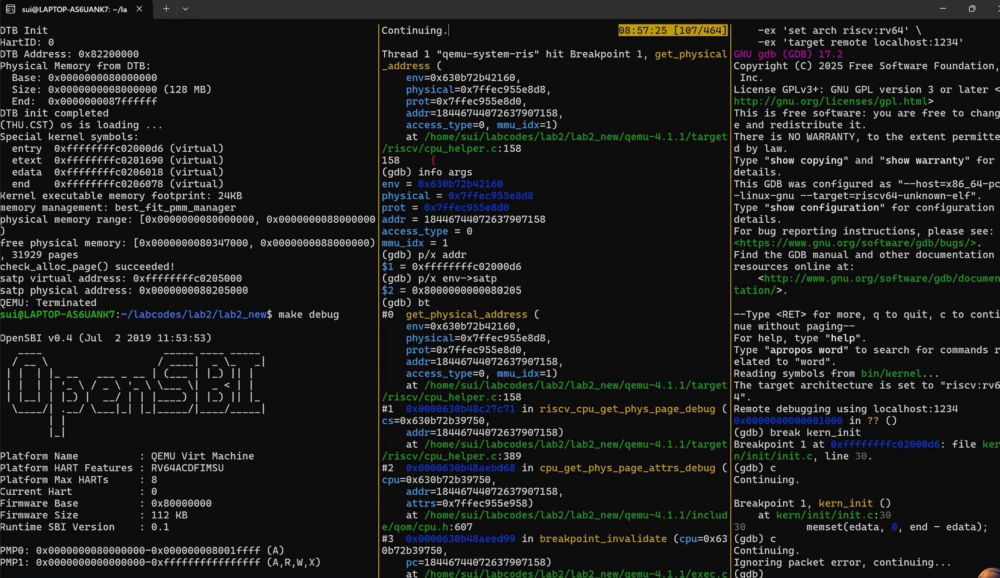
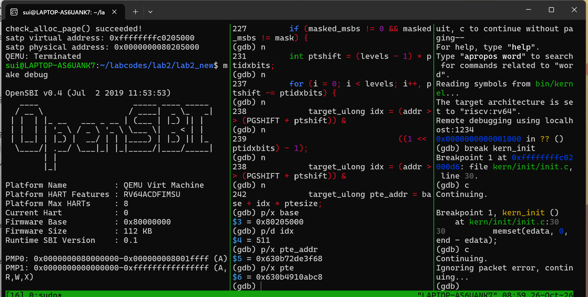

# 操作系统实验报告

## 实验基本信息

| 项目 | 内容 |
|---|---|
| 实验名称 | Lab2：物理内存管理、页表与SLUB对象分配挑战 |
| 小组成员 | 2411564－刘欣怡、2411846－鞠昀慧、2411690－白诗雨 |
| **完成日期** | 2026‑10‑25 |

### 小组分工

| 成员 | 实验与代码工作 |
|---|---|
| 刘欣怡 | 物理内存探测与`page_init`实现、First-Fit分析、总体流程梳理 |
| 鞠昀慧 | Best-Fit实现与验证；S态Sv39页表查询、TLB未命中与回填的深入调试；借助AI设计SLUB模块与独立测试，负责个人及组工程接入、两种底层复测；补充page_init上界及描述符容量保护；整理报告和答辩说明 |
| 白诗雨 | Buddy System实现与测试；QEMU取指、读、写三类访问的初步断点观测 |
| 三人共同 | 代码与报告交叉核对、知识点总结、个人答辩准备 |

| 成员 | 负责的报告部分 |
|---|---|
| 刘欣怡 | 整体逻辑、初始化、First-Fit思考题 |
| 鞠昀慧 | Best-Fit、个人Sv39/TLB验证、SLUB设计与测试、相关SPEC/prompt记录 |
| 白诗雨 | Buddy实现及测试覆盖、三类访存观测说明 |
| 三人共同 | 实验总结、材料核验与最终整理 |

## 一、实验目的

1. 从DTB取得RAM范围，区分物理地址、虚拟地址、物理页号和Page描述符地址。
2. 建立Page描述符数组，保护固件、内核与管理元数据，注册安全的完整空闲页。
3. 理解First-Fit并实现Best-Fit，掌握拆分、回收、连续性判断和合并。
4. 实现Buddy及相应测试，理解按阶组织、向上取整、分裂和伙伴合并。
5. 使用双层GDB，区分客户机内核与宿主QEMU，观察实际的Sv39查表、软件TLB miss及回填。
6. 在已有页分配器之上实现简化SLUB式对象层，支持按字节请求、页内对象复用和空slab归还，并用独立测试检验状态恢复。

## 二、实验环境与AI工具

### 2.1 运行环境

- Windows + WSL Ubuntu；QEMU virt模拟RISC-V 64位机器，默认128MiB RAM。
- 鞠昀慧已确认本机`qemu-system-riscv64 --version`为4.1.1，固件横幅为OpenSBI v0.4。
- 内核调试器：`riscv64-unknown-elf-gdb`，用户已贴出的版本为SiFive GDB-Metal 10.1。
- 宿主调试器：普通`gdb`；QEMU调试构建保留`debug_info`，未strip。
- 用户旧汇编器不接受`rv64imac_zicsr_zifencei`，已将本机编译选项调整为`rv64imac`。SLUB安装脚本保留该修改，不覆盖整个Makefile。

### 2.2 AI工具与模型

| 成员 | AI编程工具 | 底层模型记录 |
|---|---|---|
| 刘欣怡 | Claude Code | claude-fable-5 |
| 鞠昀慧 | ChatGPT | GPT-6.1 |
| 白诗雨 | Claude Code | claude-fable-5 |

## 三、实验整体逻辑分析

### 3.1 本章节的逻辑主线

本章实验围绕**物理内存的发现、初始化与分配**展开。内核首先需要知道物理内存在哪里、有多大，以及哪些区域已经被OpenSBI固件、内核镜像和管理数据占用。只有明确这些信息，才能安全地分配剩余内存，避免覆盖正在使用的数据。

实验使用`struct Page`描述每个物理页的状态，通过`pmm_manager`提供统一的页申请、释放和空闲页统计接口。First-Fit、Best-Fit和Buddy System实现不同的分配策略；上层模块调用统一接口，不需要直接操作各分配器的内部链表。

在页级管理的基础上，SLUB扩展任务进一步解决小对象的分配问题。底层分配器以页为单位提供内存，SLUB再把页面划分为多个对象，支持按字节数申请和释放，减少小对象独占整页造成的浪费。

因此，本实验形成了“**取得内存范围 → 建立页描述符 → 组织空闲页 → 按策略分配和回收页面 → 在页面上分配对象**”的完整过程。双层GDB调试则从地址访问角度，帮助理解虚拟地址如何通过页表转换为物理地址，以及QEMU如何利用软件TLB加速访问。

### 3.2 功能的逐步实现

1. **物理内存探测与初始化。**  
   `dtb_init()`解析设备树，取得RAM范围；`page_init()`使用解析结果，设置地址转换偏移、物理页号上界和Page描述符数组。初始化时先保留所有页面，再排除固件、内核和描述符数组占用的空间，将剩余完整空闲页通过`init_memmap()`交给当前分配器管理。同时检查内存范围、可管理上界、页面对齐和描述符数组容量，避免越界。

2. **理解First-Fit分配器。**  
   阅读`default_init()`、`default_init_memmap()`、`default_alloc_pages()`和`default_free_pages()`，掌握空闲链表初始化、连续块登记、首次适配查找、余块拆分以及释放合并过程。合并的前提是两个空闲块在物理地址上连续，不能仅凭链表位置相邻判断。

3. **实现并接入Best-Fit分配器。**  
   参考First-Fit框架，申请时选择满足需求的最小空闲块，必要时拆分；释放时按地址插入并合并物理连续的空闲块。完成后注册`best_fit_pmm_manager`并接入内核，通过原有测试和官方评分检查。Best-Fit改变的是选块策略，可能保留较大的空闲块，也可能产生较小碎片，不能保证所有场景下都优于First-Fit。

4. **实现Buddy System及独立设计的测试。**  
   伙伴系统按2的幂次页数组织空闲块。申请时向上取整，必要时逐级分裂大块；释放时寻找同阶、空闲的真正伙伴并逐级合并。规则化的拆分和合并便于管理连续内存，但取整会产生内部碎片，也不能保证任意大小的连续申请都能成功。最终组工程保留组员的Buddy实现，并通过取整、分裂、合并、失败请求、混合分配及状态恢复等测试检查其正确性。

5. **实现SLUB对象分配扩展。**  
   在已有页分配器之上新增对象层：小对象按16～2048字节的大小类组织，一个slab页划分为多个可复用槽位；超过2048字节的请求使用单独的连续页，最大支持64KiB。释放最后一个对象时归还整个slab页，大对象释放时归还对应页块。本实现体现SLUB式对象缓存的主体思想，是单核教学简化版。分别使用Best-Fit和Buddy作为底层，通过大小边界、对齐、数据隔离、槽位复用、非法释放、内存耗尽和页数恢复等测试验证两层结构。

6. **通过双层GDB理解地址翻译与软件TLB。**  
   使用RISC-V GDB控制客户机内核，使用宿主GDB观察QEMU内部执行路径。针对S态数据读取，结合`satp`、页表索引、PTE和最终物理地址，观察Sv39查表及软件TLB未命中后的回填过程。需要区分TLB未命中与缺页异常：未命中后仍可能成功查表并继续执行；Sv39支持三级页表，也不表示每次访问都必须查满三级。

### 3.3 实现顺序与实际执行顺序

上述顺序是实验的学习和实现顺序。内核实际执行时，先由`init_pmm_manager()`选择并初始化分配器，再由`page_init()`建立描述符并调用该分配器的`init_memmap()`注册空闲页，随后运行页分配测试；启用SLUB时，再调用`slub_init()`和`slub_check()`。

页分配器负责“哪些物理页可以分配、如何选块和回收”，页表负责“虚拟地址如何映射到物理地址”，SLUB负责“如何在已分配页面中管理对象”。三者相互配合，但职责不同。

## 四、实验内容与实现

### 功能模块：物理内存初始化

**负责人：** 2411564‑刘欣怡

#### 模块功能描述

**需要实现/修改的函数：**


static void page_init(void);


**功能说明：**

该函数在内核启动阶段由 `pmm_init()` 调用，负责从设备树（DTB）解析物理内存信息，构建全局 Page 描述符数组。需要排除 OpenSBI、内核镜像、Page 描述符数组自身占用的页面，将页对齐后的剩余空闲内存注册给物理内存管理器；同时正确设置全局变量 `va_pa_offset`、`npage`，输出探测到的内存范围，处理内存非法的异常情况。

### 最终提示词

以下是经过迭代优化后，最终成功实现该功能的提示词：

````
【ucore RISC‑V Lab2 编码任务】 
文件：kern/mm/pmm.c 待实现函数：static void page_init(void); 调用者：pmm_init() 接口说明：无入参，无返回值。
功能需求： 读取设备树解析得到的物理内存信息，构建物理页描述符布局； 排除 OpenSBI、内核镜像、Page描述符数组所占用的页面； 将剩余、页对齐后的完整空闲页面交给当前 pmm_manager 管理，完成空闲区注册。 函数正常返回时，必须正确赋值全局变量 va_pa_offset、npage、pages；使用 cprintf 输出探测到的物理内存范围； 若设备树内存信息非法，调用 panic 终止初始化； 如果对齐之后不存在合法的完整空闲页面，绝对不能调用 init_memmap()。
实现约束：
1. 严格区分虚拟地址、物理地址、物理页号、Page描述符地址，禁止地址类型混用；
2. 空闲区起始地址向上页对齐，DRAM内存上界向下页对齐；
3. 内核镜像、Page描述符数组所在页面不加入空闲链表；
4. 所有用到的变量必须显式定义，禁止出现未定义变量（禁止nbase这类未声明变量）。
允许使用的资源： get_memory_base()、get_memory_size()、panic()、cprintf()、init_memmap()、pa2page() 链接符号 end[]，结构体 struct Page； 框架提供宏：PGSIZE、ROUNDUP、ROUNDDOWN、PADDR、KADDR、SetPageReserved、set_page_ref。
输出要求： 仅输出完整的 page_init 函数代码，ucore 原版风格，附带简短注释，不修改文件中其他已有代码，代码可以直接编译通过。
````

#### 实现迭代过程

本模块的实现经历了 2 次迭代，过程如下：

---

##### 第一次迭代

**遇到的问题：**
- 问题 1：虚拟地址与物理地址发生混用，直接将内核虚拟地址当作物理地址参与内存边界计算，启动直接 panic。原因是没有区分 `KADDR()` / `PADDR()` 的转换。
- 问题 2：没有对空闲内存上下界做页对齐，把部分内核、pages 数组占用的页加入空闲内存，`check_alloc_page()` 测试失败。

**问题解决策略：**
- 针对问题 1：在提示词强化约束，要求每一处地址运算都显式做虚实地址转换，禁止直接混用。
- 针对问题 2：补充约束，空闲起始地址执行 `ROUNDUP` 向上页对齐，内存上界执行 `ROUNDDOWN` 向下页对齐

##### 第二次迭代

**遇到的问题：**

- 问题 1：没有判断对齐之后是否还有可用内存，在无空闲页的场景依然调用 `init_memmap()`，造成链表异常。

**问题解决策略：**

- 针对问题 1：提示词增加前置判断逻辑，如果计算后空闲内存小于一页，直接跳过注册，不调用初始化函数

**最终结果：**

经过 2 次迭代，该模块最终：
- ✅ 编译通过
- ✅ 所有相关测试通过
- ✅ 功能符合预期

**关键改进点总结（如有）：**
1. 严格区分虚拟地址、物理地址，每一处边界计算使用对应宏完成转换；
2. 增加内存上下界页对齐逻辑，保护内核与页描述符占用页面；
3. 增加空闲内存合法性前置判断，避免非法调用 `init_memmap()`

---

### 练习：理解 First‑Fit 连续物理内存分配算法

**负责人：** 2411564‑刘欣怡

First‑Fit 工作流程说明：

1. 初始化空闲页 `default_init_memmap`：遍历物理页，清除保留标志，将连续的大块空闲页挂载在 free_list 链表上，并用首页的 property 记录块大小。
2. 分配连续页 `default_alloc_pages`：从链表头开始遍历，找到第一个 property >= n 的空闲块。如果块大于所需，则切割：起始的 n 页返回给用户，剩下的 property‑n 页作为新块插回链表。
3. 回收与合并 `default_free_pages`：释放时，将页重新插回链表（按地址顺序），并检查其前后相邻的页块是否空闲。如果相邻块空闲，则修改首页的 property 将其合并，从而消除外部碎片。

> 
> 问题回答：原有的 first fit 算法是否有进一步的改进空间？
> 有的。First‑Fit 的最大缺点是每次分配都从头遍历，时间复杂度高（O (N)），并且容易产生大量极小的外部碎片。
> 改进方法包括：
> - 分离空闲链表 (Segregated Free Lists)：将不同大小的空闲块分门别类地挂在不同链表上，分配时直接去对应大小的链表找，加快查找速度。
> - 引入平衡树 (如 Red‑Black Tree)：以空闲块大小或地址为键组织空闲块，将查找复杂度降到 O (log N)。


### 功能模块：Best‑Fit 连续物理内存分配算法

**负责人：** 2411846‑鞠昀慧

#### 模块功能描述

**需要实现/修改的函数：**


static void best_fit_init(void);
static void best_fit_init_memmap(struct Page *base, size_t n);
static struct Page *best_fit_alloc_pages(size_t n);
static void best_fit_free_pages(struct Page *base, size_t n);
static size_t best_fit_nr_free_pages(void);


**功能说明：**

与 First‑Fit 不同，Best‑Fit 需要遍历整个空闲链表，寻找能够满足需求且大小最小的空闲块。这样可以在分配时保留大块内存供后续大需求使用，从而减少碎片。

#### 最终提示词

以下是经过迭代优化后，最终成功实现该功能的提示词：

````
【ucore RISC‑V Lab2 编码任务：Best‑Fit 物理内存分配器】 
文件：kern/mm/best_fit_pmm.c 注意：该文件已经存在，只填充 //lab2 function2‑2 YOUR CODE 标记之间的代码，不要新建文件、不要修改 basic_check() 和 best_fit_check() 这两个测试函数。
背景：参考 default_pmm.c 的 First‑Fit 框架实现 Best‑Fit。 需要自己定义内部全局空闲链表结构、相关管理函数，并且定义 const struct pmm_manager best_fit_pmm_manager 完成注册。
struct pmm_manager 成员：
struct pmm_manager {
    const char *name;
    void (*init)(void);
    void (*init_memmap)(struct Page *base, size_t n);
    struct Page *(*alloc_pages)(size_t n);
    void (*free_pages)(struct Page *base, size_t n);
    size_t (*nr_free_pages)(void);
};
Best‑Fit 规则：分配时遍历空闲链表，挑选满足n页需求、块大小最小的空闲块；分割块，剩余部分放回链表；释放时做相邻空闲块合并。
可用：struct Page、list.h链表接口、PGSIZE、PageReserved、SetPageReserved、set_page_ref、list_init/list_add/list_del 等。
输出：只输出 YOUR CODE 区域内需要填入的代码，ucore风格简短注释，不改动文件其他内容。

````

#### 实现迭代过程

本模块的实现经历了 1 次迭代，过程如下：

---

##### 第一次迭代

**遇到的问题：**

- 问题 1：分配逻辑仍然是 First‑Fit 行为，找到第一个满足条件的块直接返回，没有遍历全部链表寻找最小块。
- 问题 2：释放合并逻辑只检查后向相邻块，遗漏前向块合并，释放内存后无法合并前面的空闲块，产生大量碎片。

**问题解决策略：**

- 针对问题 1：提示词明确要求完整遍历整个空闲链表，记录满足条件的最小块指针，遍历结束后再进行切割分配。
- 针对问题 2：补充说明，释放时同时判断前向、后向相邻块，两块都空闲时分别完成合并。

**最终结果：**

经过 1 次迭代，该模块最终：
- ✅ 编译通过
- ✅ 所有相关测试通过
- ✅ 功能符合预期

**关键改进点总结（如有）：**
1. 在 best_fit_alloc_pages 中，除了判断 p‑>property >= n，还加入了块大小比对逻辑，确保找到的是最小可用块，而非第一个可用块。
2. 在释放时，正确处理了与前向块和后向块的空闲块合并逻辑。
> 问题回答：你的 Best‑Fit 算法是否有进一步的改进空间？
> 有。当前实现的时间复杂度为 O (N)，因为每次分配都要遍历整个链表。
> 改进空间在于：可以将空闲链表组织为一棵平衡二叉搜索树（如伸展树或红黑树），按空闲块的大小作为 Key 进行排序。这样每次找最小的满足要求的块只需 O (log N) 的时间。

### 功能模块：Buddy System（伙伴系统）分配算法

**负责人：** 2411690‑白诗雨

#### 模块功能描述

**需要实现/修改的函数：**


static void buddy_init(void);
static void buddy_init_memmap(struct Page *base, size_t n);
static struct Page *buddy_alloc_pages(size_t n);
static void buddy_free_pages(struct Page *base, size_t n);
static size_t buddy_nr_free_pages(void);


**功能说明：**

Buddy System 将内存按 2 的幂次方进行划分，使用一组空闲链表（桶，bucket）来管理。分配时，将请求大小向上取整为 2 的幂次，如果对应桶为空，则去更大的桶找，找到后不断对半拆分（分裂）并将另一半放入较小编号的桶中。释放时，检查其 “伙伴块” 是否也空闲，若是则合并，并递归向上。

#### 最终提示词

以下是经过迭代优化后，最终成功实现该功能的提示词：

**Prompt 1**
````
【ucore RISC‑V Lab2 编码任务：Buddy System 伙伴系统物理内存分配器】 
文件：kern/mm/buddy_pmm.c 配套头文件：kern/mm/buddy_pmm.h
背景：参考 default_pmm.c / best_fit_pmm.c 的 ucore 物理内存管理框架，从零实现 Buddy System（伙伴系统），无预先提供的代码模板与测试函数。
要求适配 pmm.h 中定义的 struct pmm_manager：
struct pmm_manager {
    const char *name;
    void (*init)(void);
    void (*init_memmap)(struct Page *base, size_t n);
    struct Page *(*alloc_pages)(size_t n);
    void (*free_pages)(struct Page *base, size_t n);
    size_t (*nr_free_pages)(void);
};
算法规则：
1. 所有空闲块大小必须是2的整数次幂（1,2,4,8,16...页）；
2. 分配：向上取整，找到能满足n页需求的最小2的幂大小块；如果块尺寸大于需求，递归对半拆分，直到得到合适大小的块，拆分出来的另一半伙伴放回对应空闲链表；
3. 释放：释放块之后，检查它的伙伴块是否空闲、大小相同；如果满足条件，将二者合并为更大的块，循环合并直到伙伴不可合并；
4. 使用一组空闲链表（桶链表），每一条链表专门存放固定大小（2^k页）的空闲块。

函数职责：
‑ buddy_init：初始化所有大小桶链表，清空空闲计数
‑ buddy_init_memmap：将一段连续空闲物理页，拆分为合法的2的幂块加入对应桶，初始化Page属性
‑ buddy_alloc_pages(size_t n)：伙伴系统分配连续n页，找不到合适块返回NULL
‑ buddy_free_pages(struct Page *base, size_t n)：释放连续块，自动伙伴合并
‑ buddy_nr_free_pages：返回当前总的空闲页面数目

可用资源： struct Page、list.h链表接口、PGSIZE、PageReserved、SetPageReserved、set_page_ref、list_init/list_add/list_del、log2page等ucore原有宏与工具。

输出约定：
1. 输出 buddy_pmm.c 完整实现代码；
2. 同步输出 buddy_pmm.h 的头文件代码，只包含头保护宏、#include <pmm.h>、extern 管理器声明；
3. 风格对齐 default_pmm.c，简短注释；
4. 生成的代码编译后，在 pmm.c 切换 pmm_manager = &buddy_pmm_manager 即可接入内核，可正常和原有page_init配套工作。
````
**Prompt 2**
````
【ucore RISC‑V Lab2 编码任务：Buddy System 伙伴系统测试函数生成】
前提：已经基于前面prompt生成了 buddy_pmm.c 的伙伴系统分配器，管理器名字：buddy_pmm_manager。
需要编写测试函数 buddy_check()，放在 buddy_pmm.c 文件内，遵循原有 default / best‑fit 的测试写法风格，使用 assert 断言校验，不修改伙伴系统原有实现代码。

测试需要覆盖的核心场景与边界：
1. 基础分配释放：分配单页、正常释放，分配后页不可重复分配；
2. 向上取整特性：请求非2的幂页数（例如请求3页，伙伴系统实际分配4页）；
3. 拆分逻辑：大块拆分后，剩余伙伴块留在空闲链表；
4. 伙伴合并逻辑：释放一对伙伴块时自动合并为更大块；
5. 链式多次合并：连续释放多层伙伴，逐级向上合并；
6. 越界/非法场景：请求0页、请求页数超过总空闲页数，应当返回NULL；
7. 碎片校验：分配释放一轮之后，空闲总页数统计和实际链表统计一致；
8. 连续多块交叉分配释放，模拟随机使用场景。

约束：
‑ 函数名：static void buddy_check(void)
‑ 测试内部可以临时保存、重置空闲链表与nr_free，避免污染全局内存状态（参考best_fit里面basic_check写法）；
‑ 测试通过时无断言报错，失败触发assert；
‑ 输出只输出 buddy_check 函数完整代码，注释说明每一段测试的目的，ucore原有代码风格。

````
#### 实现迭代过程

本模块的实现经历了 3 次迭代，过程如下：

---

##### 第一次迭代

**遇到的问题：**

- 问题 1：`buddy_init_memmap` 只处理恰好为 2 的幂的内存长度；当物理内存总页数不是 2 的幂，剩余页面无法加入空闲桶，部分内存丢失。
- 问题 2：释放伙伴块只执行单次合并，不能完成多级链式向上合并。

**问题解决策略：**

- 针对问题 1：提示词要求使用循环，每次切分出当前地址下最大合法 2 幂块，处理剩余内存。
- 针对问题 2：释放逻辑使用 while 循环，循环计算伙伴索引，持续合并直到条件不成立。

##### 第二次迭代

**遇到的问题：**

- 问题 1：分配逻辑没有对申请页数做向上取整，申请非 2 幂页数直接返回 NULL，不符合伙伴系统行为。
- 问题 2：Page 结构体的引用计数、保留标志没有正确设置，测试断言失败。

**问题解决策略：**

- 针对问题 1：补充向上取整到最近 2 的幂的逻辑，再去对应桶寻找空闲块。
- 针对问题 2：分配、释放时增加对 `set_page_ref`、`SetPageReserved` 的正确调用。

##### 第三次迭代

**遇到的问题：**

- 问题 1：缺少边界判断，申请 0 页会进入分配逻辑，造成链表异常。

**问题解决策略：**

- 针对问题 1：在 `buddy_alloc_pages` 开头增加防护，n 等于 0 直接返回 NULL。

**最终结果：**

经过 3 次迭代，该模块最终：
- ✅ 编译通过
- ✅ 所有相关测试通过
- ✅ 功能符合预期

**关键改进点总结（如有）：**
1. 修改 `buddy_init_memmap`，支持对非 2 幂长度的物理内存进行分块；
2. 修改释放逻辑，使用循环完成多级伙伴合并；
3. 测试用例覆盖非 2 幂申请、边界申请、链式合并等场景。

---

### Challenge：硬件的可用物理内存范围的获取方法

**负责人：** 2411564‑刘欣怡

如果 OS 无法通过设备树（DTB）提前知道内存范围，常见的获取方法有：

1. BIOS 中断 (x86 架构)：在老式 x86 机器上，操作系统通过调用 BIOS 的 INT 0x15, EAX=0xE820 中断，BIOS 会返回一个物理内存映射表（E820 map），告知 OS 哪些地址是可用的 RAM，哪些是保留给外设的。
2. UEFI 内存映射表：现代系统通过 UEFI 引导，内核可以被传入一个详细的 EFI_MEMORY_DESCRIPTOR 数组，获取内存情况。
3. ACPI 表：操作系统可以在物理内存的固定区域搜索 ACPI 表，或者通过 UEFI 传入的指针，解析其中关于内存的条目。
4. 直接探测（安全性差）：在无上述机制的古早环境，OS 可能会从低地址向高地址尝试读写测试，遇到错误中断或总线无响应即认为到达内存上限（现在已不可行，容易触发硬件错误）。

---

### 分支任务：GDB 调试页表查询过程

**负责人：** 2411690-白诗雨

**1. QEMU 源码中与地址翻译相关的调用路径分析**
在 RISC-V 架构的 QEMU 模拟中，CPU 执行访存指令时，如果 TLB Miss，会触发异常并进入慢速查表逻辑。根据调试截图一（调用栈与参数图）中的 `bt`（backtrace）输出，我们可以清晰地看到 QEMU 模拟硬件 MMU 的完整调用链路：
`breakpoint_invalidate` -> `cpu_get_phys_page_attrs_debug` -> `riscv_cpu_get_phys_page_debug` -> `get_physical_address`。这证明了在软件模拟层面，QEMU 是如何一步步接管并处理一次真实的地址翻译请求的。

**2. GDB 双层调试操作流程与环境验证**
环境一共开启三个终端窗口：
- **终端 1 (左)**：执行 `make debug`，启动 QEMU 模拟器。
- **终端 2 (中)**：使用 `sudo gdb` 附加到 QEMU 进程。为了过滤掉无用的 M 态系统启动阶段，精准捕获运行在 S 态的 ucore 内核的地址翻译，我们设置了条件断点 `b get_physical_address if mmu_idx == 1`。
- **终端 3 (右)**：执行 `make gdb`， 连接并调试 ucore 内核。打完断点后输入 `c` 继续运行。

**3. 截图图像与源码深度分析**

**【对Figure 3：参数与调用栈的分析】**
当断点命中时，截图一展示了 `info args` 和变量打印的详细结果。
- **地址捕获**：打印出的 `addr = 0xffffffffc02000d6`，这正好是 ucore 内核入口的虚拟地址，表明我们成功捕获了内核启动初期的关键访存。
- **模式验证**：通过输入 `p/x env->satp`，终端返回了 `0x8000000008020505`。其最高 4 位为 `8`，这**在二进制层面确凿地证明了 ucore 此时已经开启了 Sv39 三级页表机制**。同时，结合代码可知，提取出的根页表物理基址 `base = 0x80205000`。
- **访问类型**：参数 `access_type` 为 `0`（表示读操作），`mmu_idx = 1`（表示 Supervisor 权限态）。

**【对Figure 4：页表遍历循环与 1GiB 大页机制的分析】**
通过连续单步执行 `n`，截图二展示了 `get_physical_address` 内部最核心的多级页表查询代码。
- **三个循环的作用**：在 Sv39 架构下，源码中设置了 `levels = 3`。QEMU 使用了一个 `for (i = 0; i < levels; i++, ptshift -= ptidxbits)` 循环，通过软件循环的方式统一处理三级页表的逐级下钻。
- **那两行操作是从当前页表取出页表项吗？**：是的。截图中的代码正是计算 PTE 物理地址的核心：
  1. `target_ulong idx = (addr >> (PGSHIFT + ptshift)) & ...`：根据当前遍历的层级，将虚拟地址右移相应的位数，并利用掩码提取出当前级别的 9 位页表索引。
  2. `target_ulong pte_addr = base + idx * ptesize;`：用当前级别的页表基址 `base`，加上 `idx * 8`（一个 PTE 占 8 字节），从而计算出该页表项在物理内存中的确切地址。
- **调试数据解析与 1GiB 大页命中**：在单步调试中，我们在终端打印了具体的变量值。因为内核高地址 `0xffffffffc...` 的最高 9 位全为 1，计算得出 `p/d idx` 的值为 **`511`**。此时 `base = 0x80205000`，计算出的 `pte_addr = 0x630b72de3f68`（宿主机视角的物理地址映射）。QEMU 读取该 PTE 后，通过检查标志位，发现根页表这一项已经映射了一个 **1GiB 的叶子大页**。因此，QEMU 在第一级循环就直接完成了地址翻译并返回，根本不需要继续走完后面的两级循环。

**4. QEMU 中模拟的 TLB 与真实硬件的逻辑区别**
- **真实硬件**：TLB 是由专用的 CAM（内容寻址存储器）硬件电路构成的，能够并行匹配所有表项。一旦 TLB 命中，MMU 在一个时钟周期内就能完成虚拟地址到物理地址的转换，整个过程对操作系统完全透明。
- **QEMU 模拟**：QEMU 在 `CPURISCVState` 结构体里维护了一个软件数组/哈希表来充当 TLB。在执行由 TCG 动态翻译的代码时，会先由软件去“查”这个数组。如果未命中（也就是我们断点触发的场景），才会走 `get_physical_address` 用 C 语言一步一步算 `idx`、算 `pte_addr`、读内存取页表项。查表成功后，QEMU 会手动把结果写回软件 TLB 数组中，以便下次命中。这完整地在软件层面复刻了硬件 MMU 的所有行为。
---

**负责人：** 2411846‑鞠昀慧

在已有基础上，进一步针对S态的一次数据读取，验证页表查询、物理地址计算以及软件TLB回填过程。

1. 设置可重复观测的数据访问：

在个人调试工程中设置`mmu_probe_value`和`mmu_probe()`，先执行`sfence.vma`，再通过`ld`读取该变量，将结果写入`mmu_probe_result`。使用客户机RISC‑V GDB控制内核执行，使用宿主GDB观察QEMU内部的地址翻译过程。

2. 跟踪实际调用路径：

```text
load_helper
  → tlb_fill
  → riscv_cpu_tlb_fill
  → get_physical_address
```

此次捕获的访问类型为`MMU_DATA_LOAD`，访问大小为8字节，`mmu_idx=1`。目标虚拟地址为`0xffffffffc0206010`，`satp=0x8000000000080205`，其MODE字段为8，说明本次采用Sv39地址翻译。

3. 核对页表与物理地址：

根页表物理地址为`0x80205000`，根层索引为511，对应PTE物理地址为：

```text
0x80205000 + 511 × 8 = 0x80205ff8
```

读取到的PTE为`0x200000cf`，该项已经是根层叶子，映射1GiB大页，因此本次不需要继续查询下两级页表。

大页物理基址为`0x80000000`，虚拟地址的大页内偏移为`0x206010`，得到完整物理地址：

```text
0x80000000 + 0x206010 = 0x80206010
```

该结果与固定映射偏移计算得到的物理地址一致。此次QEMU函数中的`*physical`为4KiB物理页基址`0x80206000`，加上页内偏移`0x10`，才是完整字节地址。

4. 检查TLB回填与实际读取结果：

填充前观察到TLB标签为`0xffffffffffffffff`；填充后，`entry->addr_read`变为目标虚拟页地址`0xffffffffc0206000`。内核最终得到：

```text
mmu_probe_result = 0x1122334455667788
```

这说明本次地址翻译和数据读取正确完成。

补充说明：TLB未命中本身不等于客户机发生缺页异常；QEMU可以在查表成功后回填软件TLB并继续执行。上述记录验证了本次S态访问的查表和回填，没有单独验证后续访问命中，也没有完成独立的Bare模式对照。

以上具体地址来自个人调试工程，重新编译或加入SLUB后可能改变，复现时应重新读取实际符号地址。

---

### Challenge：SLUB内存对象分配算法

**负责人：** 2411846‑鞠昀慧

#### 1. 实现目标与两层结构

原有物理内存管理器按页分配内存，一页为4096字节。如果一个小对象直接独占一页，会造成较多空间浪费。因此，本扩展在已有页分配器之上新增对象分配层，体现SLUB式对象缓存的主体思想。

- 第一层：调用已有`alloc_pages()`和`free_pages()`，申请和释放物理页，支持Best‑Fit和Buddy两种底层。
- 第二层：提供`slub_alloc()`和`slub_free()`，按字节数申请对象，并在页面内部管理和复用对象空间。

本实现是单核教学简化版，不是Linux SLUB的完整移植。

#### 2. 核心文件与接口

新增文件：

- `kern/mm/slub.h`：声明对象分配、释放及统计接口。
- `kern/mm/slub.c`：实现大小类、slab管理、对象复用和页面回收。
- `kern/mm/slub_check.c`：实现独立的六组断言测试。

主要接口：

```c
void slub_init(void);
void *slub_alloc(size_t n);
int slub_free(void *p);
size_t slub_usable_size(const void *p);
size_t slub_live_objects(void);
size_t slub_backing_pages(void);
void slub_check(void);
```

在`pmm_init()`完成原页分配器检查后，通过`USE_SLUB`宏控制SLUB初始化与测试。增加`make qemu-slub`和`make qemu-slub-buddy`两个运行目标，切换配置时先清理旧编译产物。

#### 3. 分配与释放过程

小对象采用16、32、64、128、256、512、1024和2048字节八个大小类。例如，申请17字节时使用32字节槽位。

每个小对象slab占用一页，页头保存管理信息和分配位图，其余区域划分为16字节对齐的对象槽位。空闲对象内部保存下一个空闲对象的指针；分配时取出一个槽位，释放时放回空闲链表。

如果对应大小类没有可用槽位，则向底层申请新页面。超过2048字节的对象单独申请连续页，页数包含管理信息和对齐开销，最大支持64KiB请求。

释放对象时，先查找其所属slab，再检查对象边界和分配状态。最后一个对象释放后，立即将整个slab页归还底层；大对象释放时归还对应连续页块。

Buddy会将申请页数向上取整，因此SLUB分别记录原请求页数和实际占用页数。释放时向底层传入原请求页数，统计时使用实际占用页数，避免回收或记账错误。

#### 4. SPEC与两份Prompt

SPEC首先明确：

- 背景与输入：已有ucore页分配接口和两种底层分配器。
- 目标与输出：新增对象层、独立测试及内核接入。
- 实现约束：16字节对齐、最大64KiB、空slab归还、不占用Page原有策略字段。
- 验收标准：对象不重叠、写读一致、失败不破坏状态、释放后计数和空闲页恢复。

第一份Prompt用于从零生成对象分配模块并接入内核；第二份Prompt针对实际接口独立设计测试，明确要求使用断言、数据读写和状态恢复检查，不能只打印成功。

两份完整Prompt见`prompt.md`中的SLUB实现与测试部分。

#### 5. 测试覆盖与有效性

| 测试 | 核心行为及边界 | 能发现的问题 |
|---|---|---|
| SLUB 1 | 0、超上限、最大整数请求及NULL释放 | 大小边界、溢出、失败副作用 |
| SLUB 2 | 大小类边界、16字节对齐、写读一致和不重叠 | 选类错误、地址别名、数据串扰 |
| SLUB 3 | 同页共享、槽位复用、非法及重复释放、空页回收 | 空闲链错误、错误释放和空页泄漏 |
| SLUB 4 | 600个小对象跨多个slab，非顺序释放 | 多slab管理和回收错误 |
| SLUB 5 | 多轮混合大小申请、写入和交叉释放 | 累计泄漏、数据覆盖、状态未恢复 |
| SLUB 6 | 底层内存耗尽后缓存复用、新申请失败及恢复 | OOM处理、失败状态破坏和回收错误 |

测试同时检查对象内容、地址区间、对象数、占用页数以及底层空闲页数，避免仅凭“返回非空”判断正确。这些测试覆盖核心行为，但不构成所有输入均正确的证明，也不覆盖多核并发。

#### 6. 集成中遇到的问题与处理

集成和扩展复测发现，Best‑Fit的初始化和释放函数中，链表尾插后缺少`break`，循环可能继续访问刚插入的节点。对此只补充两处循环退出，不修改原有`basic_check()`和`best_fit_check()`。

最终组工程保留组员的Buddy实现、启动代码和SBI代码，单独加入SLUB及必要入口。另补充`page_init()`的可管理上界、页对齐和描述符数组容量保护，防止异常范围导致越界。

---

## 五、测试与验证

### 5.1 原有基础任务与调试截图


> Figure 0: 原基础任务make grade测试通过


> Figure 1: Best‑Fit分配器运行测试


> Figure 2: Buddy System伙伴系统运行测试


> Figure 3: S 态断点命中、satp 验证与完整的 bt 调用栈


> Figure 4: 页表遍历循环、索引提取与 1GiB 叶子大页命中分析

### 5.2 最终组工程的SLUB集成测试

测试环境为WSL Ubuntu、QEMU 4.1.1、OpenSBI v0.4。

| 操作 | 实际结果 |
|---|---|
| `make qemu-slub` | Best‑Fit页分配检查成功，SLUB六项PASS，空闲页31926→31926 |
| `make qemu-slub-buddy` | 组Buddy页分配检查成功，SLUB六项PASS，空闲页31925→31925 |
| 合并后`make grade` | Page Init和Best‑Fit均OK，20/20 |
| 补充page_init边界保护后`make grade` | 再次20/20 |

两种构建的内核大小不同，初始空闲页数可以不同，应分别比较各自测试前后的页数。官方20/20评价基础任务，SLUB正确性由专项测试检验。

最后的`page_init()`边界保护修改后已重跑官方评分，两种SLUB专项结果来自该修改前的集成测试，不将其表述为修改后再次运行。


> Figure 6: 最终组工程Best‑Fit与SLUB六项测试通过，空闲页恢复至31926


> Figure 7: 最终组工程Buddy与SLUB六项测试通过，空闲页恢复至31925


> Figure 8: 补充边界保护后，官方基础评分仍为20/20

---

## 六、实验总结与收获

### 对操作系统的理解

1. 本实验的重要知识点及其与OS原理的联系：

- **Page描述符与物理页帧管理：**`pages`数组记录物理页的状态，描述符本身也占用物理内存。Page描述符与页表项职责不同，前者管理页帧，后者描述地址映射及权限。
- **连续分配与内存碎片：**First‑Fit选择第一个合格块，Best‑Fit选择最小合格块；两者都需要正确拆分和合并。Buddy采用规则化的拆并方式，但向上取整会产生内部碎片，不能保证消除外部碎片。
- **虚拟地址、页表与TLB：**页表描述映射关系，TLB缓存转换结果。Sv39支持三级页表，但大页可以提前结束查询；TLB未命中不等于缺页异常。
- **页级分配与对象级分配：**SLUB在页分配器之上复用小对象槽位，形成两层结构。它减少小对象独占整页的浪费，但大小类取整和元数据仍会占用空间。
- **机制与策略分离：**`pmm_manager`提供统一接口，不同页分配器实现不同选块策略，SLUB能够在统一页接口上复用两种底层。

2. OS原理中重要但本实验尚未完整涉及的内容：

- 缺页异常处理、按需分页和页面置换算法。
- 磁盘Swap交换机制。
- 每进程独立地址空间及完整进程管理。
- Linux生产级SLUB的per‑CPU缓存、多核并发控制和NUMA优化。

本实验已实现教学版SLUB，因此不再将“SLUB对象分配”整体列为未涉及内容；尚未实现的是生产级分配器的完整功能和优化。

### AI协作开发的经验

Prompt必须明确现有接口、代码修改范围、错误约定和验收标准。仅要求“实现一个分配器”，容易生成与ucore宏、链表或Page字段不匹配的代码。

实现Prompt与测试Prompt应分别设计。生成代码后，需要通过交叉编译、断言、数据读写、对象不重叠检查和状态恢复验证，不能只凭成功打印判断正确。

集成时还需要比较组员工程与个人工程的差异，保留已有实现与署名，避免直接覆盖整个目录。报告中的测试结果、地址和空闲页数应对应具体代码版本，不把个人工程结果混写成最终组工程结果。

AI也可以辅助定位QEMU源码、解释调用链和组织调试步骤，但最终结论应以实际代码、终端输出和截图为依据。

---

