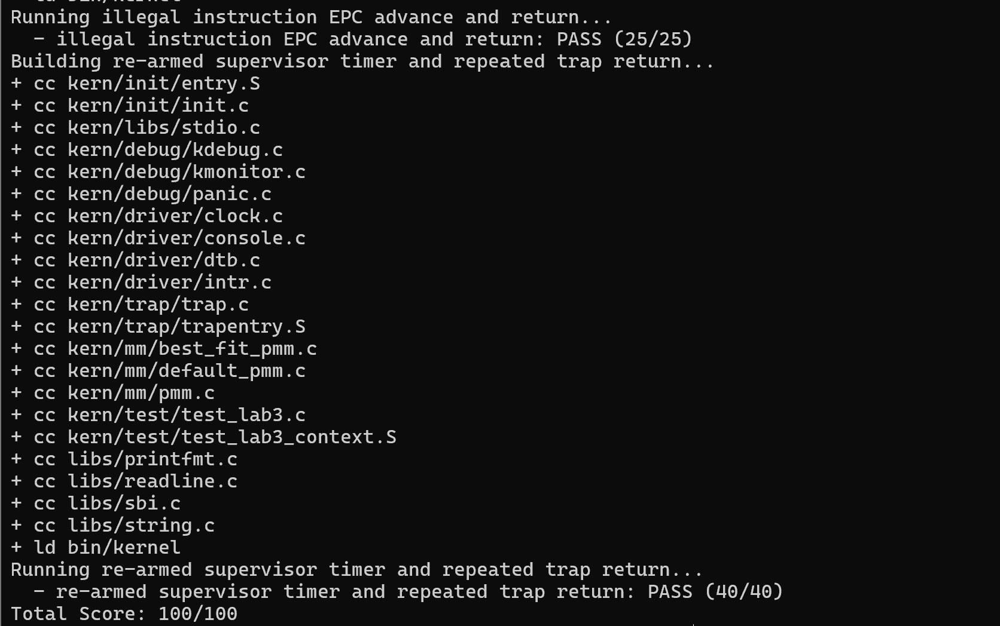
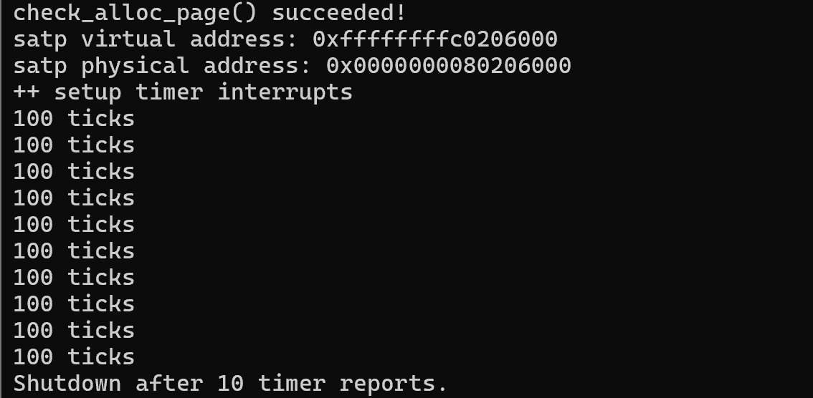

# 操作系统实验报告

## 实验基本信息

| 项目 | 内容 |
|---|---|
| 实验名称 | Lab3：RISC-V 中断处理、Trap 上下文保存与恢复 |
| 小组成员 | 2411564－刘欣怡、2411846－鞠昀慧、2411690－白诗雨 |
| 完成日期 | 2026-11-04 |

### 小组分工

| 成员 | 实验与代码工作 |
|---|---|
| 鞠昀慧 |  负责 Trap 底层上下文恢复与入口连接，包括 `RESTORE_ALL`、`__alltraps`；核对 Trap frame 布局与 RISC-V 调用约定；负责模块联调、整体测试结果核验及报告汇总 |
| 刘欣怡 |  负责 Lab2 必需依赖衔接与启动流程分析，包括 `page_init`、Best-Fit 接入检查；负责时钟中断分支、计数、事件重设及关机逻辑的实现分析与测试 |
| 白诗雨 | 负责非法指令、断点异常和未识别类型的兜底处理；负责指令长度与 EPC 更新分析、官方评分项目梳理、相关测试材料整理 |

| 成员 | 负责的报告部分 |
|---|---|
| 鞠昀慧 | 整体逻辑、上下文恢复、汇编入口、相关 SPEC/Prompt、集成验证和最终整理 |
| 刘欣怡 | 实验环境、Lab2 依赖、时钟中断、计数关机、对应 SPEC/Prompt |
| 白诗雨 | 异常分类、断点与非法指令返回、兜底输出、对应 SPEC/Prompt、知识点对照 |

## 一、实验目的

1. 理解 RISC-V 中 Trap 的含义，区分异步中断与同步异常。

2. 理解 `stvec`、`sstatus`、`sepc`、`scause` 等 CSR 的作用，以及硬件处理和软件处理的边界。

3. 阅读 `SAVE_ALL`，理解通用寄存器与控制状态在内核栈中的保存布局。

4. 实现与保存布局一致的 `RESTORE_ALL`，保证原程序执行状态能够恢复。

5. 建立汇编入口 `__alltraps` 与 C 语言函数 `trap(struct trapframe *tf)` 之间的调用关系。

6. 处理时钟中断，完成下一次事件设置、累计计数、周期输出及规定次数后的关机。

7. 处理断点和非法指令异常，根据对应指令长度推进 EPC，避免重复执行异常指令。

8. 通过官方评分和普通运行验证完整的“进入 Trap—保存—处理—恢复—返回”流程。

## 二、实验环境与 AI 工具

### 2.1 运行环境

| 项目 | 配置 |
|---|---|
| 主机系统 | Windows 11 |
| 开发环境 | WSL Ubuntu 24.04 |
| 模拟平台 | QEMU `virt`，RISC-V 64 位 |
| QEMU | 沿用 Lab1/Lab2 已安装的 4.1.1 |
| 交叉编译工具 | `riscv64-unknown-elf-` 工具链 |
| 内核运行模式 | S 模式，启动固件提供 SBI 服务 |
| 启动分页 | Sv39，高地址直接映射 |
| 构建方式 | GNU Make |
| 评分方式 | 原工程 `make grade`，通过临时副本注入三组测试 |

本实验继续使用此前能够完成 Lab2 的环境。运行脚本先检查 QEMU 版本，再探测汇编器是否支持 `rv64imac_zicsr_zifencei`；若不支持，则使用旧工具链接受的 `rv64imac`。ABI 显式使用 `lp64`。

脚本用于减少环境差异，不改变官方测试内容或判分规则。

### 2.2 AI工具与模型

| 成员 | AI编程工具 | 底层模型记录 |
|---|---|---|
| 刘欣怡 | Claude Code | GPT-6 |
| 鞠昀慧 | ChatGPT | GPT-6.1 |
| 白诗雨 | Claude Code | claude-fable-5 |

## 三、实验整体逻辑分析

### 3.1 本章节的逻辑主线

Lab2 解决了物理页如何组织和分配的问题；Lab3 进一步解决 CPU 在当前执行流之外收到事件或遇到异常指令时，内核如何接管并恢复执行的问题。

操作系统不能假设程序会主动让出 CPU，也不能只在程序正常执行时工作。定时事件、断点和非法指令都会改变处理器控制流。内核必须首先保存现场，再处理原因，最后恢复被打断的执行状态。

因此，本章围绕三条相互连接的主线展开：

1. **上下文保存与恢复：** 用 Trap frame 保存通用寄存器和关键 CSR，处理结束后恢复。

2. **入口与返回：** 将 `stvec` 指向汇编入口，连接到 C 处理函数，再通过 `sret` 返回。

3. **中断与异常处理：** 根据 `scause` 分派原因，执行相应处理，并决定是否调整返回位置。

只有三者保持一致，系统才能反复处理中断，而不会在第一次返回时破坏现场。

### 3.2 功能的逐步实现

首先补齐上传框架中标有 `lab2` 的缺失依赖，保证物理内存初始化能够完成。随后对照 `SAVE_ALL` 和 `struct trapframe`，确定每个寄存器的槽位，补全 `RESTORE_ALL`。再建立 `__alltraps` 到 `trap()` 的参数传递，最后实现中断和异常分支。

验证时先运行官方评分，检查寄存器恢复、异常返回和连续时钟；随后普通启动，观察十次计数输出和关机提示。两种测试覆盖的行为不同，应结合判断。

### 3.3 实际启动顺序

`kern_init()` 的主要顺序如下：

1. 清零 BSS，解析 DTB，初始化控制台并输出内核信息。

2. 调用 `idt_init()`，将 `stvec` 设置为 `__alltraps`。

3. 调用 `pmm_init()`，初始化并检查物理页分配器。

4. 按框架保留的流程再次调用 `idt_init()`。

5. 调用 `clock_init()`，初始化 ticks、使能时钟来源并安排第一个事件。

6. 调用 `intr_enable()`，打开 S 模式的全局中断使能。

7. 进入循环，等待时钟事件。

原框架保留了两处 `idt_init()`，评分注入器在最后一处之后插入异常测试。为保持框架与测试的对应关系，本次没有擅自删除这一调用。

### 3.4 一次 Trap 的完整执行过程

处理器记录异常位置和原因，更新 Trap 相关控制状态，并将控制权转到 `stvec`。汇编入口执行 `SAVE_ALL`，在当前内核栈建立中断帧；将帧地址放入 `a0` 后调用 `trap()`。C 函数根据原因完成处理并返回，汇编执行 `RESTORE_ALL`，最后执行 `sret`。

硬件不会替内核保存全部通用寄存器，也不会自动为本实验完成完整的栈现场保护。硬件记录的控制状态和软件保存的寄存器共同构成可返回的现场。

## 四、实验内容与实现

### 功能模块：Lab2 依赖衔接与启动检查

**负责人：** 2411564－刘欣怡

#### 模块功能描述

上传框架中，`kern/mm/pmm.c` 的 `page_init()` 和 `kern/mm/best_fit_pmm.c` 的主体仍然缺失。它们是 Lab3 启动前的必要依赖，应补齐后再验证中断机制。

`page_init()` 使用当前框架的 DTB 接口读取内存信息，设置 `va_pa_offset`、`npage`、`pages`，保护内核和 Page 数组，再将页对齐后的剩余内存注册到分配器。Best-Fit 通过统一 `pmm_manager` 接口提供初始化、分配、释放和检查。

本次补写与当前框架匹配的依赖，没有直接覆盖整个 Lab2 文件，也没有把此前 Buddy 或 SLUB 扩展当作 Lab3 必做内容移入。

#### SPEC

- **输入：** DTB 内存范围、内核结束符号 `end[]`、当前 Page 结构和直接映射边界。

- **输出：** 合法的页描述符数组和空闲页范围。

- **约束：** 区分虚拟地址与物理地址；空闲起点向上页对齐；上界向下页对齐；不将内核和描述符数组加入空闲链表。

- **验收：** 内存管理初始化和现有分配器检查成功，不阻塞后续中断初始化。

#### 最终提示词

```text
【任务】ucore RISC-V Lab3：补齐 Lab2 必需依赖
【输入材料】当前工程 kern/mm/pmm.c、pmm.h、memlayout.h、dtb.h、
             default_pmm.c、best_fit_pmm.c 以及其已有自测。
【目标】补齐 page_init 和 Best-Fit 主体，使 Lab3 可以完成内存初始化。
【page_init 要求】
1. 从 get_memory_base/get_memory_size 获取 DTB 内存范围。
2. 区分物理地址、虚拟地址和页号，设置 va_pa_offset、npage、pages。
3. 注意 npage 是物理页号上界，Page 数组元素数是 npage-nbase。
4. 以当前 KERNTOP 和映射偏移限制可管理范围；内存上界向下页对齐。
5. Page 数组从 end 之后按页对齐放置；数组结束后向上页对齐再注册空闲页。
6. 保护固件、内核和元数据；范围非法或没有可用整页时按当前实现断言终止，
   不调用非法的 init_memmap。
【Best-Fit 要求】
完整扫描空闲链表，选择满足请求且最小的块；分裂余块；释放时按地址插入，
只合并物理连续的前后空闲块；维护 property、flags、ref 与 nr_free。
定义 best_fit_pmm_manager，保留原 basic_check 和 best_fit_check。
【修改范围】只填 Lab2 标记处的依赖，保留 Lab3 的中断保护、DTB和启动接口。
【输出】给出待填代码与接口说明，不整份覆盖旧文件，不移入 Buddy/SLUB。
【验收】内核能完成 pmm_init 与当前分配器检查；单独说明 Best-Fit 的测试范围。
```

#### 实现核对与结果

静态审查发现两处 Lab2 标记仍为空缺，先补齐依赖再进行 Lab3 测试。普通运行实际显示：

```text
check_alloc_page() succeeded!
```

这证明当前默认分配器检查完成。当前 `pmm.c` 选择的是 `default_pmm_manager`，因此这条普通运行输出不能单独作为 Best-Fit 已在 QEMU 下切换测试的证据。补齐的 Best-Fit 通过制作阶段的主机端原有检查，但两者的验证范围应区分。

### 功能模块：Trap 上下文恢复 RESTORE_ALL

**负责人：** 2411846－鞠昀慧

#### 模块功能描述

**需要实现的汇编宏：** `kern/trap/trapentry.S` 中的 `RESTORE_ALL`。

`SAVE_ALL` 已将寄存器保存到栈上，本模块必须按照完全相同的布局恢复。若恢复偏移错误，程序可能在返回后使用错误的寄存器值；若提前恢复栈指针，后续读取将不再指向中断帧。

#### Trap frame 布局

| 槽位 | 对应内容 | RV64 字节偏移 |
|---|---|---:|
| 0 | x0 | 0 |
| 1 | x1 / ra | 8 |
| 2 | 原 x2 / sp | 16 |
| 3～31 | x3～x31 | 24～248 |
| 32 | sstatus | 256 |
| 33 | sepc | 264 |
| 34 | badvaddr | 272 |
| 35 | scause | 280 |

共36个寄存器宽度，在 RV64 中为288字节。该大小是16的整数倍，原栈对齐正确时仍能满足 C 函数调用的栈对齐要求。

#### SPEC

- **输入：** `sp` 指向 `SAVE_ALL` 建立的 Trap frame。

- **输出：** 恢复通用寄存器、`sstatus`、`sepc` 与原来的 `sp`。

- **约束：** 不修改 `SAVE_ALL` 和结构体布局；从帧读取尚未完成前不能改变基址 `sp`；临时寄存器也要恢复。

- **验收：** 官方现场测试中的寄存器值保持，断点处理后能够继续执行。

#### 最终提示词

```text
【任务】ucore RISC-V Lab3：补全 RESTORE_ALL
【输入材料】kern/trap/trapentry.S 的原 SAVE_ALL、trap.h 的 trapframe、
             libs/riscv.h 中的 LOAD、STORE、REGBYTES 定义。
【输入状态】sp 指向当前中断帧，帧内是要恢复的寄存器状态。
【输出状态】恢复通用寄存器、sstatus、sepc与原栈指针，供既有sret返回。
【布局约束】
槽0～31对应x0～x31，槽32为sstatus，33为sepc，34为badvaddr，35为cause。
槽2保存的是分配中断帧之前的sp，而不是当前帧地址。
【实现要求】
1. 不修改 SAVE_ALL、struct trapframe 或 trap 函数签名。
2. sp仍指向帧时先加载并写回sstatus、sepc。
3. 恢复x1、x3～x31；用作临时变量的t0/t1也必须恢复其原值。
4. x0不必加载；最后从槽2恢复x2，之后不再使用旧帧基址读取内容。
5. 不将badvaddr/scause误当成返回必需的可写控制状态。
6. 不强制清除SPP；返回到哪种模式由保存的状态决定。
【输出】仅输出RESTORE_ALL标记处的汇编，并解释恢复顺序与偏移对应。
【验收】原SAVE_ALL逐字不变；官方现场测试能保持被检查的寄存器并返回。
```

#### 核心实现与分析

先使用 `t0`、`t1` 读取第32、33项，再执行 `csrw sstatus, t0` 与 `csrw sepc, t1`。随后恢复除 x0、x2 外的通用寄存器，其中包括刚才作为临时变量使用的 t0/t1。最后执行：

```asm
LOAD x2, 2*REGBYTES(sp)
```

`badvaddr` 和 `cause` 保留在帧中用于分析，不需要为了 Trap 返回而写回。恢复不能简单地理解为“所有保存过的 CSR 都逐个写回”。

#### 实现核对与结果

核对时重点排查了槽位偏移、临时寄存器覆盖和 sp 恢复时机。原有 `SAVE_ALL` 保持不变。官方评分总分100/100，结合三项判分结构，说明现场与断点返回项目已通过。

本模块通过布局核对和现场测试验证恢复逻辑；检查重点是寄存器偏移、栈基址和控制状态三者的一致性。

### 功能模块：汇编入口与 C 语言处理函数连接

**负责人：** 2411846－鞠昀慧

#### 模块功能描述

补全 `__alltraps` 保存现场之后的调用部分，将当前中断帧作为参数传给：

```c
void trap(struct trapframe *tf);
```

#### SPEC

- 进入时已经执行 `SAVE_ALL`，当前 `sp` 是帧地址。

- 第一个参数按照 ABI 放入 `a0`。

- `trap()` 返回后，`sp` 仍指向同一个中断帧。

- 沿用 `__trapret` 中的 `RESTORE_ALL` 和 `sret`。

#### 最终提示词

```text
【任务】ucore RISC-V Lab3：连接汇编入口与C处理函数
【文件】kern/trap/trapentry.S
【已有条件】__alltraps先执行SAVE_ALL，sp此时指向当前trapframe。
C接口为 void trap(struct trapframe *tf)，后续已有__trapret、RESTORE_ALL和sret。
【目标】将当前帧指针传入trap，处理完后继续既有恢复路径。
【要求】
1. 按RISC-V ABI将第一个参数放入a0，传入帧地址而非帧中保存的原sp。
2. 使用正常的函数调用指令连接trap，不另建一份帧。
3. 不改变现有帧布局；trap返回后sp应与调用前一致。
4. 原ra已在帧中保存，最后由RESTORE_ALL恢复；不要混淆C调用ra与原现场ra。
5. 保持入口四字节对齐，保持16字节栈对齐，不删除现有__trapret/sret。
【输出】最少必要汇编，并说明a0、sp、ra的变化。
【验收】trap能接收到正确指针；返回后现有RESTORE_ALL仍读取同一帧。
```

#### 核心实现

```asm
mv a0, sp
jal trap
```

`jal` 写入当前调用的返回地址，原程序的 ra 已在帧中保存。`trap()` 正常返回后继续执行 `__trapret`，恢复的 ra 才是被打断程序原本的值。

#### sret 的含义

`sret` 使用 `sepc` 决定返回位置，并根据保存的 `sstatus.SPP` 决定返回模式。它还按架构规则恢复中断使能状态。本实验从 S 模式内核进入 Trap，返回后继续内核执行，不能将其写为“每次都返回用户态”。

### 功能模块：时钟中断、计数与关机

**负责人：** 2411564－刘欣怡

#### 模块功能描述

在 `interrupt_handler()` 中识别中断原因，重点实现 `IRQ_S_TIMER`。时钟中断不能只打印一次信息，还必须不断安排新的事件，才能重复触发。

#### SPEC

1. 清除 `tf->cause` 最高位的中断标志，取得原因号。

2. 每次时钟中断调用 `clock_set_next_event()`。

3. 每次时钟中断让 `ticks` 增加一次。

4. 当 `ticks` 为 `TICK_NUM` 的整数倍时调用 `print_ticks()`。

5. 输出次数达到 `SHUTDOWN_AFTER` 后调用 `sbi_shutdown()`。

6. 其他已知中断输出类别，未知中断输出原因并打印完整现场。

上传框架有 `TICK_NUM=100`，但没有给出 `SHUTDOWN_AFTER` 的定义。本实现使用默认值10，允许编译宏覆盖；这表示十次统计输出，对应1000次中断，不是十次中断。

#### 最终提示词

```text
【任务】ucore RISC-V Lab3：实现 interrupt_handler
【文件与接口】kern/trap/trap.c，void interrupt_handler(struct trapframe *tf)
【可用资源】clock_set_next_event、ticks、TICK_NUM、print_ticks、
             print_trapframe、IRQ_*常量及sbi_shutdown（sbi.h）。
【输入】tf->cause为当前原因；RV64最高位是中断标志。
【功能要求】
1. 用uintptr_t宽度清除最高位，提取原因号，不直接用带标志的值与IRQ常量比较。
2. IRQ_S_TIMER每次调用clock_set_next_event并递增ticks一次。
3. 每当ticks到达TICK_NUM整数倍调用print_ticks。
4. 使用可跨调用保留的报告次数；达到SHUTDOWN_AFTER后调用sbi_shutdown。
5. 当前框架没有SHUTDOWN_AFTER定义时，用#ifndef提供默认10；它表示10次报告。
6. 不修改时钟中断的tf->epc；周期性来自重复安排事件。
7. 其他框架已有中断类型输出对应名称；IRQ_S_SOFT须包含
   Supervisor software interrupt。未知原因输出Unknown interrupt: cause N，
   然后调用print_trapframe。
【修改范围】只补Lab3标记和必要include，不改print_ticks或评分文件。
【输出】完整处理函数、默认宏及必要头文件，解释ticks与reports的区别。
【验收】官方时钟测试达到ticks=200并输出100 ticks；普通运行1000次后进入关机。
```

#### 关键代码

```c
clock_set_next_event();
ticks++;
if (ticks % TICK_NUM == 0) {
    print_ticks();
    if (++reports >= SHUTDOWN_AFTER) {
        cprintf("Shutdown after %d timer reports.\n", SHUTDOWN_AFTER);
        sbi_shutdown();
    }
}
```

`reports` 是静态变量，用于跨多次函数调用累计报告次数。若写为每次进入函数都清零的普通局部变量，就无法达到十次报告后关机的条件。

#### 时钟来源与全局使能

`clock_init()` 使能 `sie` 中的时钟来源，并安排第一次事件；`intr_enable()` 设置 `sstatus.SIE`。只设置其中一项不能代表整个时钟中断机制都已就绪。

框架每次通过 SBI 设置一个未来时间点，因此处理函数必须重设下一次事件。名义10ms间隔下，100次约一秒；主机负载和处理时间会影响实际运行时间，不能把十行输出当作精确十秒计时。

#### 实现核对与结果

官方时钟项目实际输出 `PASS (40/40)`。普通运行截图包含十行 `100 ticks` 和最终关机提示，说明事件能够持续触发，计数与报告次数条件达到预期。截图本身不包含 Ubuntu 提示符，因此关机退出状态不单凭该图作进一步推断。

### 功能模块：断点、非法指令异常与兜底处理

**负责人：** 2411690－白诗雨

#### 模块功能描述

`exception_handler()` 根据 `tf->cause` 区分异常。非法指令和断点需要输出对应信息，并推进 `tf->epc`，使返回后执行下一条指令；其他未要求恢复的异常只打印中断帧。

#### SPEC

| 异常 | 处理方式 |
|---|---|
| `CAUSE_ILLEGAL_INSTRUCTION` | 输出 `Illegal instruction at`，按测试指令长度推进 EPC |
| `CAUSE_BREAKPOINT` | 输出 `Breakpoint at`，按测试指令长度推进 EPC |
| 其他异常 | 调用 `print_trapframe(tf)` |

对当前实验中的16位和32位编码，读取指令低16位：低两位不是 `11` 时长度为2字节；测试范围内其余情况按4字节处理。

#### 最终提示词

```text
【任务】ucore RISC-V Lab3：实现 exception_handler
【文件与接口】kern/trap/trap.c，void exception_handler(struct trapframe *tf)
【输入】tf->cause为同步异常原因，tf->epc为异常指令地址。
【功能】
1. CAUSE_ILLEGAL_INSTRUCTION输出Illegal instruction at及EPC。
2. CAUSE_BREAKPOINT输出Breakpoint at及EPC。
3. 对这两类异常按测试中实际指令长度推进tf->epc，确保返回后不重复执行。
4. 当前测试涵盖16位压缩断点和32位指令；读取可读内核代码的低半字，
   低两位不等于3时加2，测试范围内其余情况加4。
5. 测试中的.word 0x0000007b应推进4字节；ebreak不要无条件按4字节处理。
6. 其他异常只调用print_trapframe，不擅自推进EPC或增加通用恢复逻辑。
【边界】不宣称支持更长编码；不直接将这种内核指令读取方法用于任意用户地址。
【约束】保留函数签名、trap_dispatch、trap及原有其他函数，不改官方测试。
【输出】完整函数，解释未推进和推进错误的后果，说明适用范围。
【验收】断点和非法指令处理后继续执行，兜底分支输出满足原评分要求。
```

#### 关键实现与原因

```c
uint16_t insn = *(const volatile uint16_t *)tf->epc;
tf->epc += ((insn & 3) == 3) ? 4 : 2;
```

如果不更新 EPC，`sret` 会返回原异常指令，再次触发异常。若对16位压缩断点固定加4，则可能跳过后面的指令或落在错误边界。

官方非法指令测试使用 `.word 0x0000007b`，为32位指令；断点测试的 `ebreak` 在启用压缩扩展时可能生成16位编码。本实现针对这两类测试正确推进。

该方案要求 EPC 指向的内核代码可以读取；它不适用于直接解引用任意用户地址，也不支持所有更长编码。真实非法指令异常也不一定应该跳过，本次按教学实验要求处理。

#### 兜底处理

已知中断输出类型；未知中断输出原因并打印帧。未要求实现恢复的异常只打印帧，不人为将所有异常统一跳过。若真实执行流持续触发未处理异常，仍可能重复进入处理函数，不能把“输出现场”理解为“问题已经恢复”。

官方测试构造了软件中断、未知中断和未知异常的帧，直接调用处理函数检查输出。这属于函数分支测试，不代表实际触发了全部硬件来源。

## 五、实现检查、问题处理与 AI 迭代

### 5.1 记录原则

本次先阅读实际工程再补全代码，制作阶段完成局部检查，随后在 WSL 运行官方测试并取得100/100。没有记录到用户端先失败再修复的评分过程，因此不套用参考报告中“经历若干次运行失败”的表述。

下面列出实际发现的缺失和静态问题，以及实现时采用的约束。

| 问题或风险 | 发现依据 | 解决方式 |
|---|---|---|
| Lab2 依赖仍为空缺 | 原始工程中的两处 lab2 标记 | 补齐 page_init 和 Best-Fit 主体 |
| 恢复布局必须匹配 SAVE_ALL | 实际汇编槽位及结构体 | 按原偏移恢复，SAVE_ALL 保持不变 |
| sp 提前恢复会丢失帧基址 | 对照保存流程分析 | 将 x2 最后恢复 |
| 压缩断点不能统一推进4字节 | 原测试汇编及 ISA 设置 | 对测试中的16/32位编码分别处理 |
| 只设置首个定时事件无法周期触发 | SBI接口和clock实现 | 每次中断重新安排下一事件 |
| SBI内联汇编未明确声明被修改寄存器 | 原sbi_call约束 | 使用绑定a0/a1/a2/a7的读写操作数 |
| 开启分页后的过渡指令仍在物理启动地址 | 原预设页表和entry.S | 增加启动恒等映射，保留高地址根项 |
| 汇编器版本对扩展名称支持不同 | 之前环境与当前构建配置 | 使用脚本探测并选取可接受的ISA参数 |

### 5.2 SBI 约束检查

原内联汇编直接移动到 x10、x11、x12、x17 并执行 ecall，却未完整表达这些固定寄存器的读写关系。编译器不了解汇编文本的隐含寄存器影响，可能错误安排输入值或保留变量。

修正后通过绑定 a0/a1/a2/a7 的寄存器变量和读写约束明确接口，并保留 memory clobber。该调整属于底层调用可靠性修正，不改变 SBI 定时和关机接口含义。

### 5.3 启动分页映射检查

原页表仅提供第511项的内核高地址映射。为使写入 satp 之后、跳往高地址之前的指令仍可取指，增加根页表第2项的恒等映射：物理启动地址所在的1GiB区域仍映射到自身。

第511项仍用于将内核高地址映射到物理内存。这里是启动过渡处理，没有实现用户地址空间隔离，也不应宣称解决了完整的虚拟内存保护问题。

### 5.4 AI 协作过程

先明确 SPEC，包括输入输出、修改范围、不变量和验收标准；随后依据实际接口形成 Prompt，由 AI 辅助生成与检查实现。再将代码与框架比对，确认 SAVE_ALL 和原评分文件未变，最后通过实际测试核验。

本报告及独立文件 `prompt.md` 中的 Prompt 按实际工程接口整理，用于复现本次实现过程；它们是整理后的任务说明，不是逐字导出的聊天记录。

## 六、测试与验证

### 6.1 测试层次

制作阶段对修改的 C 文件进行语法检查，并用主机端桩接口验证 Best-Fit 自检、EPC更新、时钟重设及报告计数。这些局部测试不能验证 CSR、SBI、真实寄存器和 sret。

随后在实际 WSL 环境执行老师的评分与普通运行，取得本报告的主要验收证据。原评分脚本和注入工具均未修改。

### 6.2 官方评分

运行命令：

```bash
cd ~/os_group_submit/OS_lab3_2411846
bash run_lab3.sh grade
```

官方评分将测试注入临时工程副本，分别构建三个场景。

| 测试项目 | 分值 | 检查内容 | 结果 |
|---|---:|---|---|
| Trap entry、register restore、breakpoint EPC | 35 | 汇编入口、寄存器恢复、断点返回 | 通过，由总分100/100及原判分结构确认 |
| Illegal instruction EPC advance and return | 25 | 非法指令跳过、返回与兜底输出 | 已提供截图确认 PASS (25/25) |
| Re-armed supervisor timer and repeated trap return | 40 | 重设事件、连续中断、ticks达到200 | 已提供截图确认 PASS (40/40) |
| 总计 | 100 | 三项综合评分 | **100/100** |

实际评分截图显示非法指令项目 `PASS (25/25)`、连续时钟项目 `PASS (40/40)`，最终总分为 `Total Score: 100/100`。第一个35分项目位于截图上方未完整显示，其通过状态由原评分脚本的分值构成及总分确认。

```text
Running illegal instruction EPC advance and return...
  - illegal instruction EPC advance and return: PASS (25/25)
Running re-armed supervisor timer and repeated trap return...
  - re-armed supervisor timer and repeated trap return: PASS (40/40)
Total Score: 100/100
```

上面摘录了截图中可见的评分结果，省略中间的编译行。



> Figure 1：官方评分结果，非法指令测试25/25、连续时钟测试40/40，三项总分100/100。

官方评分说明当前测试集合内的功能满足要求，不等于对所有指令、所有异常或多核场景的完整正确性证明。

### 6.3 普通运行：内存、时钟与关机条件

运行命令：

```bash
bash run_lab3.sh run
```



> Figure 2：内存检查成功，时钟初始化后连续输出十行100 ticks，最后到达十次报告后的关机分支。

| 观察内容 | 实际输出 | 说明 |
|---|---|---|
| 物理页检查 | `check_alloc_page() succeeded!` | 当前默认页分配器检查通过 |
| 根页表虚拟地址 | `0xffffffffc0206000` | 当前构建的根页表所在虚拟地址 |
| 根页表物理地址 | `0x0000000080206000` | 对应物理地址 |
| 时钟初始化 | `++ setup timer interrupts` | 初始化路径已执行 |
| 周期统计 | 十行 `100 ticks` | 共累计1000次时钟中断 |
| 关机条件 | `Shutdown after 10 timer reports.` | 已进入计数达到阈值后的关机路径 |

每一行 `100 ticks` 表示又经过100次中断，不是ticks一直保持100。报告次数与总中断数是不同的计数。

截图没有显示退出后的命令提示符，故图像直接证明的是关机分支已到达。若需在材料中证明 QEMU 已退出，可另补一张包含返回 Ubuntu 提示符的截图。

### 6.4 页表地址对应关系核对

本次截图中的虚实地址差为固定映射偏移：

```text
0xffffffffc0206000 - 0xffffffff40000000 = 0x80206000
```

与打印的根页表物理地址一致。这是当前启动信息的对应核对，没有重新进行 Lab2 的 QEMU 源码级双层 GDB 页表遍历，不把它表述为完成了新的TLB调试实验。

具体符号地址随编译结果变化，报告引用的是当前截图数值，不要求其他构建保持相同地址。

### 6.5 测试材料归档

| 文件 | 内容 | 状态 |
|---|---|---|
| `images/grade_success.png` | 官方评分及100/100总分 | 已插入 |
| `images/timer_shutdown.png` | 内存检查、十次100 ticks和关机提示 | 已插入 |
| `prompt.md` | 各模块SPEC、实现提示词与集成核验提示词 | 已提供 |

两张图分别对应评分场景和普通运行场景。评分注入代码只出现在临时副本中，原始工程不需要为了截图永久加入这些测试调用。

## 七、重要知识点及与 OS 原理的联系

| 实验知识点 | OS 原理概念 | 含义、联系与差异 |
|---|---|---|
| Trap分类 | 中断与异常 | 异步定时事件与同步指令异常都可转入处理入口，但返回位置策略不同 |
| SAVE_ALL/RESTORE_ALL | 上下文保护 | 保存与恢复被打断执行流；尚未选择其他进程运行 |
| trapframe | 中断现场 | 是栈上的寄存器快照，不等于PCB，也不是进程调度结构 |
| stvec与分派函数 | 中断向量机制 | 本实验使用Direct统一入口，在C代码中分派原因 |
| sepc与EPC更新 | 异常恢复 | 定时中断保持执行位置；本实验断点与非法指令按长度跳过 |
| sstatus与sret | 特权级返回 | 按SPP决定返回模式，不能把返回统一理解为S到U |
| SBI定时接口 | 固件与内核协作 | 内核通过固件安排时钟事件，没有直接实现M模式定时处理 |
| ticks和周期事件 | 时钟驱动操作系统 | 可为未来调度提供基础，本次没有实际进程抢占切换 |
| local_intr_save/restore | 临界区保护 | 保留原状态后关闭本核中断，不等于通用多核互斥 |
| 页分配器依赖 | 内核模块衔接 | 内存管理先完成，才能保持整体启动流程可用；中断保护也服务于分配器操作 |

### 7.1 为什么 Trap 保存不能只遵循普通函数的 callee-saved 集合？

普通函数调用遵循调用者与被调用者的协定，调用者知道哪些寄存器可能被破坏。异步中断可以在任意指令之间到来，被中断代码并没有主动调用处理函数，因此必须保护其现场，不能仅保存普通C函数规定的被调用者保存寄存器。

### 7.2 为什么不能对所有 Trap 都执行 EPC+=4？

时钟中断不需要跳过正常指令；压缩断点只有2字节；真实缺页异常通常在修复映射后重新执行原指令；不同原因需要不同策略。本实验只对规定的断点和非法指令按当前测试长度推进。

### 7.3 为什么需要两种测试？

官方评分注入断点、非法指令以及计数等待，覆盖多个处理分支；普通运行展示完整启动、持续计数和最终关机条件。评分中的时钟场景在ticks达到200时就打印通过，不能仅凭该场景证明1000次之后的关机分支，因此还需结合普通运行结果。

### 7.4 为什么关闭本地中断不是多核锁？

关闭本核中断可以避免当前核的中断处理与临界区交错，但其他核心仍可能访问共享数据。多核情况下还需要锁、原子操作和内存顺序保证。本实验没有进行相关并发验证。

## 八、OS 原理中重要但本实验未完整涉及的内容

1. **进程与线程管理：** 未建立完整PCB、就绪队列、进程创建和退出机制。

2. **抢占式调度：** 已有时钟事件，但没有根据时间片切换到另一个任务。

3. **用户态系统调用：** 没有实现用户程序系统调用号、参数检查与用户指针访问；内核调用SBI不等于完整用户系统调用机制。

4. **缺页异常恢复与页面置换：** 未实现按需分页、换入换出及替换算法。

5. **外部设备中断：** 已知类型提示输出不等于完整PLIC配置、设备应答和驱动服务。

6. **多核并发与嵌套中断：** 当前单核教学验证不覆盖多核共享数据、内核栈切换和通用嵌套恢复。

7. **完整用户地址空间隔离：** 现有启动映射不是完整的每进程独立页表与权限设计。

## 九、实验总结与收获

### 9.1 对中断处理的理解

本实验的重点不是分别写出几个处理函数，而是让现场布局、参数传递、原因分派、返回位置和特权级状态组成一致的流程。任意一处不一致，都可能在第一次返回或后续中断中暴露问题。

通过对照 SAVE_ALL 与 RESTORE_ALL，能够理解保存与恢复之间的严格对应关系；通过 sp 最后恢复的要求，能够理解栈不仅是局部变量存储区域，也承担跨汇编与C代码交接现场的功能。

通过时钟测试，能够理解周期行为依赖于重复设置事件，而不只是计数自增。通过异常测试，能够理解返回位置是软件处理策略的一部分，不能简单地让所有 Trap 从同一位置或同一偏移返回。

### 9.2 AI 协作开发的经验

有效的 Prompt 需要绑定实际工程接口和修改范围，明确 SAVE_ALL 不可修改、sp最后恢复、函数签名不变、计数条件和输出要求。只要求“实现中断”容易遗漏底层约束。

代码生成后要核对实现与测试的关系。成功打印不一定能证明正确；官方测试还检查寄存器、执行位置和持续计数。主机端桩测试只能验证局部逻辑，不能取代真实 RISC-V 运行。

报告记录同样需要区分静态发现、实际运行和推测风险。本次已取得官方100/100及普通时钟运行截图，应据此更新结果，不再将整体功能写为待验证；同时不虚构未出现的运行失败、工具使用记录或额外调试经历。

### 9.3 最终结果

本次完成 Trap 上下文恢复、汇编与 C 入口连接、时钟中断计数及关机条件、断点与非法指令处理。官方三项评分合计100/100；普通运行输出内存检查成功、十次100 ticks和关机分支提示。

本报告已包含实际评分截图和普通运行截图。提交前补入真实小组仓库链接，核对成员及工具记录，并将报告、提示词和图片与当前实际代码版本一起归档。

